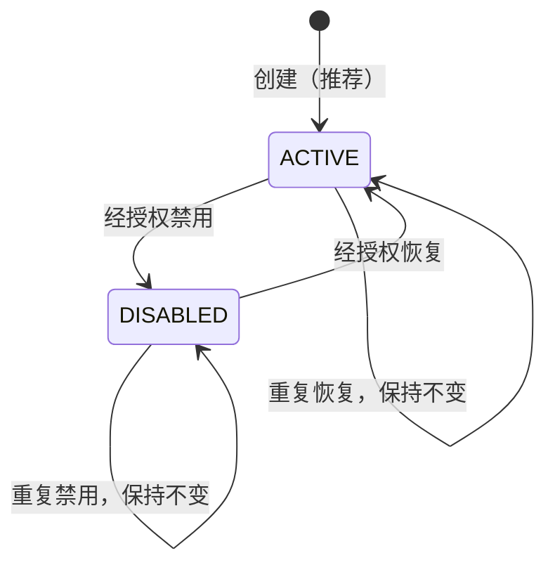
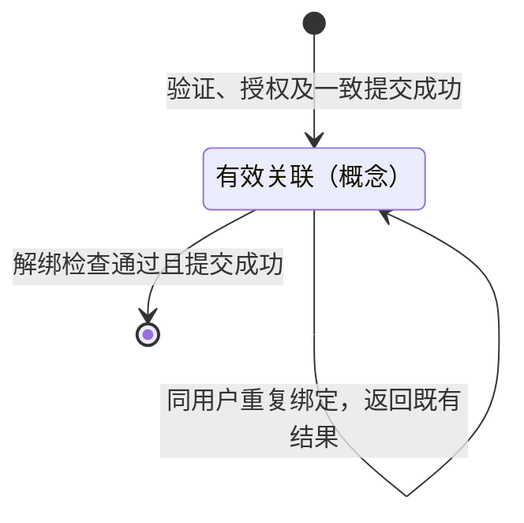
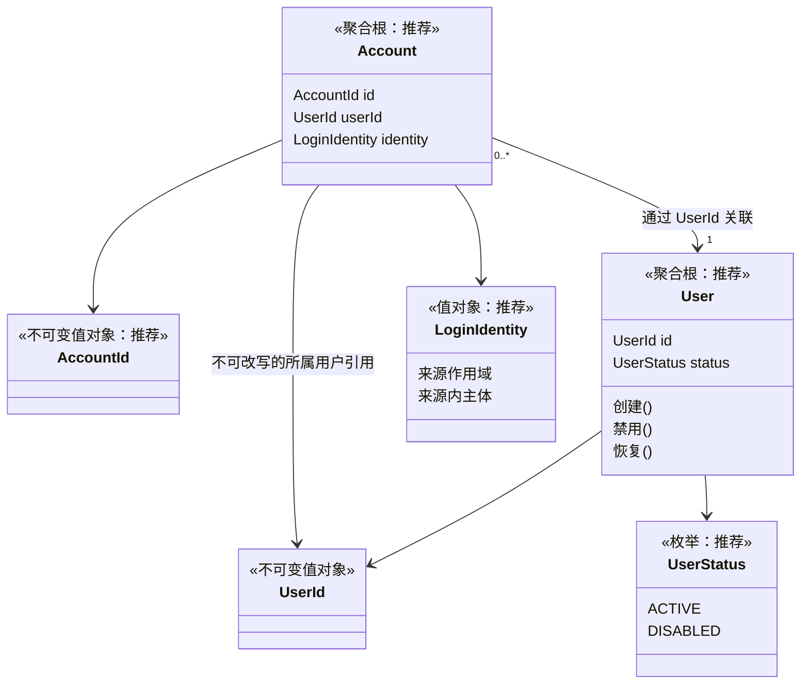

# Pikdo Identity 领域设计（I0）

## 1. 背景、目标与设计状态

Pikdo 当前优先服务个人自媒体用户，未来逐步支持团队和企业。目标架构为模块化单体 Java Server、独立 Python Collector，以及后续设计的异步采集任务体系。现阶段采用用户级数据归属，不建立完整多租户体系。

本文建立 Identity 的业务模型设计基线，供领域评审及后续 I1 User、I2 Account 纯 Java 建模使用。它不表示用户系统已经实现，也不授权直接进入代码实现。

### 1.1 规则来源与阅读方式

| 标记 | 含义 | 对后续实现的约束 |
| --- | --- | --- |
| 已确定 | 本次任务明确给出的边界与原则 | 后续设计不得与之冲突 |
| 推荐 | 本文基于现有业务目标给出的评审方案 | 评审确认前不是已批准需求 |
| 待决策 | 业务依据不足，仍有实质选择 | 应依照第 12 节判断是否阻塞 I1/I2 |

本文的状态表、场景步骤和图采用同一条推荐主线；使用这些内容时，应同时保留其“推荐”属性。安全约束描述的是未来系统必须满足的业务条件，不代表已有技术措施。

### 1.2 仓库基线与现状

- 调查 HEAD：`4b7088f8281caea11fea5c7b241c9f64ac6721c4`，初始 Git 工作区干净，本文此前不存在。
- Server 使用 Java 21、Spring Boot 4.1.1，目前只有 Web 配置、异常处理、Request ID、国际化、Swagger 和 Actuator 等基础设施，没有 User、Account、认证或持久化业务。
- Collector 已提供单条输入的小红书商品采集、商品解析及安全输出；当前没有用户体系、业务数据所有权管理、任务调度或与 Java Server 的通信。
- 根目录及 Server README 仍采用“商家和电商运营”的定位。本文以本次明确的个人用户优先定位为准；README 后续可独立调整，本次不修改。
- `docs/1.Github开源项目参考.md` 是桌面软件参考设计，不能据此认定 Pikdo 已采用其中的数据存储、用户或任务模型。

阅读依据包括根 `AGENTS.md`、根及 Server README、Server 的 `Application`、包级约定、异常与 Request ID 配置、Maven 配置，以及 Collector README、采集入口和相关契约。本文不改变它们的现有行为。

### 1.3 非目标

本阶段不选择实际登录方式，不实现密码处理、验证码、OAuth/OIDC 协议、Token、Session 或授权框架；不设计 HTTP 接口、数据库表、索引、DDL、ORM 映射或 Repository 接口；不创建 Java 类、业务目录、依赖或配置。也不实施用户注销、数据删除、团队管理或任何采集业务。

## 2. 领域术语表

| 术语 | 本文统一含义 | 不应混同 |
| --- | --- | --- |
| Identity | 管理平台用户及其登录身份的领域模块、限界上下文 | 名为 Identity 的聚合根或通用身份实体 |
| User | Pikdo 内部长期稳定的用户主体 | 邮箱、手机号、第三方用户或企业账户 |
| UserId | User 的稳定、不透明业务标识，也是用户数据归属的引用 | 登录标识、AccountId、客户端提供的所有者声明 |
| Account | 与一个 User 关联的登录账号或登录身份绑定 | User、租户、订阅账户、第三方内容账号 |
| AccountId | 标识一次 Account 实例的独立领域标识，推荐采用 | UserId 或登录身份的全局唯一键 |
| 登录身份 | 在约定身份来源作用域内识别登录主体的身份标识 | 密码、验证码、访问令牌或展示资料 |
| 身份来源 | 定义主体标识含义与作用域的可信来源或本地身份命名空间 | 仅供展示的提供方名称 |
| 归属验证 | 证明操作者能够以产品认可的方式控制某个登录身份 | 证明该身份天然拥有某个既有 User 的全部权限 |
| 认证凭据 | 用于证明登录身份的秘密或技术材料，由未来认证设施管理 | User 或 Account 必须直接保存的业务属性 |
| 有效绑定 | 已完成可信验证和一致提交、尚未结束的 Account 关联 | 待验证输入、历史关联、认证 Session |
| 可用登录身份 | 有效绑定且具备至少一种产品认可、未撤销的登录能力，适用于正常用户的登录保障判断 | Account 数量、某次网络探测成功、认证方式数量 |
| 用户级所有权 | 业务资源通过 UserId 归属于用户 | 通过当前邮箱、AccountId 或浏览器 Cookie 判定所有权 |

同一邮箱若同时支持密码与验证码，可以是同一个登录身份的两种认证方式，不应机械建立两个 Account。绑定微信登录身份，也不代表已绑定或获准采集该用户的微信、小红书等内容账号。

“可用”需要首版登录方式确定后进一步落实。临时提供方故障不应自动结束绑定；凭据撤销、登录能力移除等变化则可能影响可用性，不能只统计有效 Account 的条数。

## 3. Identity 边界与职责

**已确定：** Identity 负责平台用户身份、User 生命周期、登录身份与 User 的关联、绑定与解绑规则、身份唯一性，以及向其他领域提供稳定的 UserId 语义。

| 边界内 | 边界外及协作责任 |
| --- | --- |
| 定义用户是否处于可正常使用的业务状态 | 认证设施验证凭据，创建和管理具体登录会话 |
| 定义一个登录身份当前关联哪个 User | 身份来源适配方完成可信归属验证及来源作用域解释 |
| 定义绑定、解绑、唯一性及禁止直接转移的业务规则 | 未来应用层协调授权、跨聚合操作与持久化并发保证 |
| 提供稳定 UserId 和用户状态语义 | Collection、Catalog 自行维护任务、商品、历史数据及其归属 |
| 定义禁用对身份业务的限制 | 受保护操作的执行入口落实状态与资源所有权检查 |

Identity 不负责商品采集、历史快照、任务调度、第三方内容账号、订阅计费、组织团队和认证协议。Request ID 只用于请求关联，不能作为 UserId 或用户认证证据。

后续纯 Java 模型不应依赖 Spring、HTTP 状态、JSON、认证 SDK 或持久化框架。现有 `ErrorCode`、`BusinessException` 等 Web 异常类型依赖 Spring HTTP，适合作为未来边界适配对象，不应直接成为纯领域模型的父类型或接口。领域失败先用业务语义描述，后续由应用/Web 边界映射；I0 不新增错误码体系，也不修改现有错误响应。

## 4. User 领域模型

### 4.1 含义与最小构成

**已确定：** 一个 User 是一个独立、稳定的 Pikdo 业务身份。UserId 创建后不变，不直接使用邮箱、手机号或第三方标识；更换登录方式不更换 UserId。禁用不等于删除用户或业务数据。

**推荐：** User 为聚合根，最小模型只包含 UserId 与 UserStatus。UserId 是按值比较的不可变标识值对象，生成方式和编码格式不在 I0 确定。UserStatus 采用 ACTIVE、DISABLED 两个值。

不把邮箱、手机号、密码、头像、昵称、账号数量或 Account 集合作为 User 最小模型的必需组成。当前没有资料编辑需求；也没有依据让 User 保存一份跨聚合账号计数并独自宣称其准确。

概念行为为“创建”“禁用”“恢复”。创建工厂仅表达合法 User 对象的建立，不等同于注册用例已经完成，不验证验证码或签发登录凭据。

### 4.2 创建时机

**推荐：** 首次注册流程在登录身份完成可信归属验证后，才尝试创建 User；User 与首个 Account 一致提交成功后，才对外表示注册成功。验证中断或身份冲突不应留下可被当成已注册用户使用的孤立 User。

User 对象在内存中先被构造，不代表它已被发布为可登录用户。纯 User 对象不拥有跨聚合提交能力。“先建待验证 User”或“首次登录即注册”仍是产品备选方案；若采用，必须另行明确待验证语义和失败生命周期，不能偷偷扩展当前两状态模型。

### 4.3 状态与数据归属

**推荐：** 禁用保留原 Account 关联，正常的自助登录和绑定变更被拒绝；恢复沿用同一 UserId 和既有绑定。Account 保留不等于禁用期间仍可登录，恢复也不自动使已撤销或失效的认证材料重新有效。

历史商品、采集任务及快照仍属于原 UserId。Identity 不直接修改这些数据，也不因状态变化触发未经设计的数据删除或迁移。正在执行的采集任务是否暂停、取消或继续，由未来 Collection 规则决定，不由 User 状态方法顺带实现。

## 5. Account 领域模型

### 5.1 业务含义及最小属性

**推荐：** Account 是独立聚合根，表达某个登录身份与 User 的一次有效关联，最小概念构成为：

| 概念组成 | 理由及限制 |
| --- | --- |
| AccountId | 标识独立关联实例；不泄露邮箱或手机号，也不因身份标识作为唯一键而绑定实体标识策略 |
| UserId | 引用所属 User，创建后不可改写；不存在直接转移方法 |
| 登录身份值 | 表达来源作用域和该作用域内的主体，用于判断身份等价；不装载认证秘密 |

不预设独立的 Provider 实体、完整提供方枚举、Credential 继承树、任意扩展属性 Map、主账号标记、账号优先级或时间戳清单。它们需要实际产品用例才能进入模型。

AccountId 是推荐选择，不是已确认需求。使用登录身份值或 UserId 与身份值的组合标识作为替代方案，可以减少独立 ID，但会把实例身份、可重用的登录标识和关联历史耦合在一起。独立 ID 的代价是增加一种标识及其生命周期管理；在独立聚合方案下，本文认为这一代价合理，仍需 I2 前评审。

### 5.2 身份等价、验证与凭据

**已确定：** 第三方登录身份不能仅凭邮箱相同自动认定为同一 User。对于 OIDC 类身份，发行方与主体标识共同确定身份，不只使用主体，也不能只使用提供方展示名。

身份来源与标识的规则按首版实际支持方式制定：

| 候选方式，均不代表首版已选定 | 身份语义 | 归属验证与凭据边界 |
| --- | --- | --- |
| 邮箱登录 | 平台认可的邮箱身份命名空间及其规范化邮箱标识 | 邮箱控制权验证与密码等凭据分开；不能把邮件地址字符串视为验证结果 |
| 手机号登录 | 平台认可的号码作用域及规范化号码标识 | 号码控制权与长期用户主体分开；号码可能重新分配 |
| 第三方登录 | 可信来源作用域内的主体；OIDC 场景考虑发行方与主体二元语义 | 验证来源及归属由适配方负责；声明中的邮箱、昵称等不替代主体标识 |

本文不制定统一的小写化、邮箱去点、别名合并、号码格式或发行方字符串改写算法。第三方主体应视为来源定义的不透明值。来源范围、等价与规范化规则不确定时，不能声称全局唯一性已得到定义。

**推荐：** 只有可信归属验证和目标 User 操作授权均满足，才能发起有效绑定。验证结果必须适用于本次身份、目标用户和操作目的；其有效期、防重放和消费方式由后续认证/应用边界设计。客户端传入的 `verified=true`、邮箱已验证标记或一个 UserId，不构成可信证据。

当前控制邮箱或手机号，不等于证明自己是它长期对应的同一个人。身份重新分配后，仅凭当前控制权识别既有 User 可能造成接管；首版认证与恢复策略必须评估这一风险，不能宣称身份唯一性或一次归属验证已将其消除。敏感绑定变更需要怎样的既有身份再次确认，也需后续明确；新身份的控制证明不能替代这一确认。

密码变更、验证码生成、OAuth 回调、Token 和 Session 均不进入 Account 行为。原始验证材料和认证秘密不应因设计便利而成为 Account 的属性或可公开内容。

### 5.3 最小生命周期及解绑表示

**推荐主线：** Account 仅代表有效关联。创建成功意味着绑定已完成；未验证输入和验证过程不是 Account。解绑是结束当前关联的业务流程，不是禁用 User，也不是删除该 User 的数据。

在这一主线下，暂不引入 AccountStatus。解绑由未来应用层协调相关聚合和有效关联存储，成功提交后，该 Account 不再属于有效绑定集合。纯 Account 对象没有能够独立完成解绑的 `unbind()` 方法，也不提供接收旧账号数量就判定可解绑的接口。

| 表示方案 | 收益 | 代价与适用条件 | 本文判断 |
| --- | --- | --- | --- |
| 有效关联存在，结束后退出有效集合 | 模型小，不为不存在的账号冻结、审核等需求增加状态 | 解绑及历史保留需要流程明确表达；旧内存对象不能自行证明当前关联仍有效 | 推荐作为最小主线，待 I2 评审确认 |
| 同一实体保留 BOUND/UNBOUND | 可以明确表达关联终止，便于查询原实例生命周期 | 增加终止态规则和所有查询的有效性条件，仍需跨聚合协调 | 若确认需要保留可查询的终止实体，应重新评估 |

两种方案都必须保证“关联结束后不能再用于识别有效登录用户”。不使用枚举不代表通过物理删除抹除历史；使用 UNBOUND 也不代表保存所有原始身份资料是必需的。历史记录的目的、内容、保留期限和删除责任仍待决策。

**推荐：** 同一 User 重新绑定已经结束的身份，需要重新满足验证和授权，建立新的 Account 实例及 AccountId，不复活旧的有效关联。其他 User 能否使用已经释放的身份，需要单独确定身份再分配与恢复策略；在决策前，不把“查不到有效绑定”视为自动获准重绑给任何用户。

按推荐主线，同一 Account 实例始终不允许改变 UserId。将来若允许不同 User 先后使用同一个登录身份，也必须是结束旧关联后、经过独立授权和验证的新关联，不是直接转移或自动合并用户。

首次注册、新增绑定与重新绑定必须遵循同一套已确认的身份准入规则，不能通过换一个用例名称绕过重用限制。D-08 历史保留与 D-10 重用策略应共同决定：如果不保留辨别历史关联所需的信息，就不能承诺执行依赖该历史的限制。

## 6. 聚合边界比较与推荐

| 比较项 | 方案 A：Account 在 User 聚合内部 | 方案 B：User、Account 分别作为聚合根 |
| --- | --- | --- |
| 一致性边界 | 一个 User 及其全部绑定，用户内修改可在一个聚合中表达 | User 状态与单个 Account 分开，绑定流程需要协调 |
| 用户内重复绑定与最后账号规则 | 已完整加载且掌握可用性时较直接；仍不能忽略并发写入 | 需要对同一 User 的相关变化进行一致检查与提交 |
| 跨用户身份唯一性 | 两个 User 聚合之间仍然无法单独保证 | 两个 Account 聚合之间同样需要全局并发保证 |
| User 生命周期 | 登录身份改动与用户状态共享对象边界 | 用户主体可保持小而稳定，绑定有独立关联生命周期 |
| 聚合大小 | 个人用户预计账号少，规模当前不是决定性问题；增加账号会扩大加载与冲突范围 | 单个绑定保持小，但增加查询和协调责任 |
| 新登录方式 | 常影响 User 内部账号建模 | 若身份语义兼容，可局部扩展；不因此提前引入提供方框架 |
| 主要风险 | 容易误把 User 1:N Account 当成必须整体加载，或误认为已解决全局唯一性 | 若只拆对象却不落实跨聚合一致性，会发生重复归属或最后账号并发解绑 |

**推荐方案 B。** User 的业务连续性不依赖具体登录方式，Account 关联可以结束或重新建立，而 UserId 必须保持稳定。这是划分的主要业务依据；不是为了避开一致性问题，也不是因为当前个人用户账号数量庞大。

方案 A 在账号少、用户内一致性占主导时是合理替代方案。若 I2 评审发现关联没有足够独立的业务身份，应允许回到方案 A，而不是为了保住“两个聚合根”的形式增加冗余对象。

### 6.1 一致性责任

单个 User 聚合负责自身标识和合法状态；单个 Account 聚合负责自身标识、身份值和所属 UserId 的不可变性。它们不能单独保证用户存在、归属验证、全局唯一或剩余可用登录身份。

**推荐：** 绑定、解绑和首次注册在未来模块化单体内采用能够一致提交并判定并发冲突的应用/持久化边界。必须覆盖：

- 规范化后同一身份的“占用检查与建立关联”不能被两个请求分别成功完成。
- 同一 User 的“检查剩余可用身份与结束关联”不能被两个解绑请求同时绕过。
- 绑定修改与 User 禁用之间，需要在提交边界重新确认状态，防止只在流程开始时检查。
- 首个 Account 冲突或提交失败时，不得对外发布半完成注册；成功结果应对应一致的 User 与绑定。

这些流程不能仅依靠普通的先查询再保存，也不能只依赖某个 Java 进程中的锁。本文不选择数据库或锁方案，不设计索引；未来选型必须证明这些条件，而不是以纯领域测试替代并发集成测试。

## 7. 生命周期与状态迁移

### 7.1 User 最小状态机（推荐）

| 操作与当前状态 | 前置条件 | 结果 | 非法或无变化行为 |
| --- | --- | --- | --- |
| 创建 | 获得合法且独立的 UserId；应用流程已决定建立用户 | 创建 ACTIVE 对象 | 缺少或非法标识则拒绝；注册是否成功仍取决于跨聚合提交 |
| 禁用 ACTIVE | 应用层确认操作权限及目标；聚合处于已知状态 | DISABLED，保留 UserId | 不自动删除或解绑 Account，不改业务数据 |
| 禁用 DISABLED | 同样满足操作授权 | 保持 DISABLED | 推荐幂等，不重复执行状态变化副作用 |
| 恢复 DISABLED | 应用层确认恢复权限及业务资格 | ACTIVE，沿用 UserId | 不创建新 User，不重新启用失效凭据 |
| 恢复 ACTIVE | 同样满足操作授权 | 保持 ACTIVE | 推荐幂等 |
| 构造未知状态或改写标识 | 无合法业务路径 | 拒绝操作 | 原对象保持有效，不增加隐含状态或删除语义 |

图中授权是应用流程前置条件，不是 User 对象验证管理员身份。禁用及恢复由谁发起、是否允许用户自助发起仍待产品决策；本阶段不为此建立管理员、角色或权限模型。

禁用应阻止后续受保护操作，但不能仅凭 User 的一次状态修改宣称所有既有 Session、Token 或正在执行的操作已被立即撤销。未来认证/授权入口需要在约定执行边界使用可信用户状态；已开始的操作与禁用的先后语义、状态读取新鲜度及会话失效措施需后续落实。

注销、永久删除和注册待验证状态没有足够明确的业务规则，均不进入第一版状态机。尤其不能用 DISABLED 代替数据清除、身份释放或注销完成。

### 7.2 Account 有效关联生命周期（推荐）

| 业务动作 | 条件与结果 | 失败或边界 |
| --- | --- | --- |
| 首次绑定 | 用户及操作具备资格，身份验证可信，全局占用检查与关联一致提交；产生有效 Account | 任何条件不满足均不建立有效关联 |
| 绑定同一 User 已持有的身份 | 前置验证与授权满足，返回既有绑定，不新增 Account | 不因“重复请求”而绕过必要安全检查；请求重放处理留给未来应用边界 |
| 绑定其他 User 的有效身份 | 拒绝 | 不转移、不自动合并 User，也不根据邮箱相同归并 |
| 解绑普通身份 | 身份确属操作目标 User，User 为 ACTIVE，仍有其他可用身份；一致提交后关联结束 | 检查失败保持关联；最终规则待评审 |
| 解绑最后一个可用身份 | 推荐拒绝，保留原关联 | 不以先移除再尝试恢复的方式处理 |
| 找不到属于目标 User 的有效关联 | 拒绝，不执行解绑 | 不以历史记录或任意 AccountId 推断当前操作权限 |
| 已禁用 User 修改绑定 | 推荐拒绝自助操作 | 未来恢复或受控例外需单独设计，不默认绕过 |
| 原用户重绑已结束的身份 | 推荐重新验证、重新授权、新建关联实例 | 不复用旧证明，不因历史关联复活旧 Account |

这是一次关联存在与结束的示意，不声明 AccountStatus 枚举。终点不意味着物理删除历史记录；重新绑定是新实例，不是图中旧实例返回起点。

“最后一个可用登录身份”按身份判断，不把同一邮箱的密码和验证码算成两个独立保障。若未来有凭据撤销或登录能力移除流程，它们也必须参与失去全部登录能力的保护；仅把解绑流程串行化不足以解决所有变化。如果这些能力由不同设施维护，I2 用例落地前须明确其权威来源及一致性方案，无法确认可用性时应拒绝可能造成失联的变更。

## 8. 领域不变量清单

下表中的“纯单测”仅指未来不依赖 Spring、网络或持久化的领域单元测试。标记“部分”表示能验证局部条件，不能据此证明完整不变量。所有失败均为业务结果描述，不是本阶段新增的异常码或 HTTP 状态。

| 编号 | 业务描述及来源 | 所属对象或流程 | 触发场景 | 违反时的预期行为 | 未来保证层次 | 纯单测 |
| --- | --- | --- | --- | --- | --- | --- |
| U-01 | 已确定：UserId 不可变，且不取自登录身份 | User | 创建、恢复、更换登录方式 | 拒绝缺失或非法标识；不提供改写标识的行为 | 值对象与 User；标识生成唯一性另由应用/基础设施落实 | 部分：可验证不可变和合法性，不能证明全局生成唯一 |
| U-02 | 推荐：User 只处于 ACTIVE 或 DISABLED | User | 创建、还原及状态变化 | 拒绝未知状态；已存在对象不进入半有效状态 | User 及未来还原边界 | 是 |
| U-03 | 推荐：创建产生 ACTIVE，禁用和恢复仅按状态表转换 | User | 创建、禁用、恢复 | 非法输入拒绝，状态不变 | User | 是 |
| U-04 | 推荐：重复禁用及恢复幂等 | User、状态变更流程 | 重复业务请求 | 保持现有状态；不伪造第二次状态变化 | 聚合保证状态；应用层避免重复执行变化副作用 | 部分 |
| U-05 | 已确定：禁用和恢复不更换 UserId、不自动删除历史数据 | User、业务模块 | 禁用、恢复 | 拒绝隐含身份替换或越界数据删除 | User；Collection/Catalog 及应用层保护数据归属 | 部分 |
| U-06 | 推荐：禁用 User 不能新获正常访问能力或执行受保护操作 | 识别、认证与授权流程 | 登录、受保护请求 | 拒绝继续授予业务访问；不把识别成功当成授权成功 | Identity 状态语义；未来应用与认证/授权执行入口 | 否，须流程与集成验证 |
| U-07 | 推荐：禁用保留绑定，恢复不自动激活失效凭据 | 状态及认证流程 | 禁用、恢复后登录 | 保持关联；无有效认证能力时仍拒绝登录 | 应用层、认证设施；User 不操作凭据 | 否 |
| A-01 | 已确定：一个 Account 不能同时属于多个 User；推荐：同一实例的所属 UserId 终身固定 | Account | 创建、绑定、尝试转移 | 按推荐模型拒绝改写所属 UserId | Account；还原边界验证合法标识 | 是：可验证推荐模型的本实例不可改归属 |
| A-02 | 已确定：同一有效登录身份全局最多关联一个 User | 绑定及注册流程 | 并发绑定、注册 | 至多一个关联成功；冲突请求不建立第二个归属 | 明确的身份等价规则；应用层与持久化并发保证 | 否，纯值比较不能证明全局唯一 |
| A-03 | 推荐：同一 User 重复绑定相同身份不增加 Account | 绑定流程 | 重复或并发绑定 | 安全前置条件满足时返回既有绑定，不重复建立 | 应用层幂等处理与持久化并发保证 | 部分：可验证等价判断，不能证明并发结果 |
| A-04 | 已确定：有效绑定前必须完成可信身份归属验证 | 绑定及注册流程 | 提交新身份 | 无可信证明则拒绝，不能接受自报验证标记 | 未来来源适配方与应用信任边界 | 否，模拟证明不等于完成真实验证 |
| A-05 | 已确定：结束关联后不能继续作为有效登录身份使用 | 解绑与身份识别流程 | 解绑后登录或重放旧关联 | 有效关联查找不返回已结束关联；拒绝据此授予访问 | 应用层、有效关联持久化及认证执行边界 | 否；如采用终止态，可额外验证局部状态 |
| A-06 | 推荐：变更不能使已注册用户失去最后一个可用登录身份 | 解绑及改变登录能力的流程 | 解绑、凭据撤销等 | 拒绝造成失联的变更，原关联保持有效 | 可用性权威来源；同用户相关流程的一致检查与提交 | 否，传入计数不能证明全局条件 |
| A-07 | 已确定：禁止未经授权的身份转移或合并；新身份控制证明不等于目标 User 的操作授权 | Account、绑定流程 | 改写所属用户、账号合并 | 拒绝无权操作及自动合并；推荐完全不提供直接转移 | 应用层验证操作权限；Account 不可改归属是推荐模型的局部保证 | 部分 |
| A-08 | 推荐：绑定与解绑必须针对已授权的目标 User | 绑定变更流程 | 任意账号关联操作 | 拒绝无权操作，不因掌握新身份就授予旧用户权限 | 未来可信执行身份与应用授权边界 | 否 |
| A-09 | 推荐：禁用 User 不接受自助绑定变更 | 状态与绑定变更流程 | 禁用期间绑定/解绑、并发禁用 | 在一致提交边界拒绝不满足状态要求的变更 | 应用层协调 User 与 Account，持久化落实冲突处理 | 否 |
| A-10 | 已确定：第三方身份不按相同邮箱自动归并 | 身份等价与识别流程 | 第三方登录、绑定 | 使用来源作用域内主体识别，不自动关联其他 User | 身份值规则及来源适配方；未来应用流程 | 部分：可验证不同作用域/主体不等价 |
| A-11 | 推荐：AccountId 标识单次实例，原用户重绑建立新实例 | Account 关联生命周期 | 解绑后重绑 | 不复活旧 Account；保留原 UserId 数据归属 | 标识规则、应用及持久化边界 | 部分；是否采用独立 ID 待确认 |
| A-12 | 已确定：认证秘密不因身份建模而成为公开业务资料 | 领域边界及输出 | 创建对象、记录日志、输出 | 拒绝在领域展示或输出中夹带认证秘密 | 模型边界、认证设施及未来输出适配 | 部分 |
| A-13 | 推荐：有效 Account 引用已存在或同次一致建立的 User | 绑定及注册流程 | 建立有效关联、首次注册 | 拒绝孤立绑定，不发布只有关联而没有用户的结果 | 应用层确认目标存在；持久化边界保证一致提交 | 否，持有一个合法 UserId 值不能证明用户存在 |
| F-01 | 推荐：首次注册必须一致建立用户与首个有效绑定 | 注册流程 | 首次注册、提交失败 | 不发布半完成注册；冲突不留下可用的孤立用户 | 应用层及未来持久化原子提交 | 否 |
| O-01 | 已确定：业务资源按 UserId 归属，不按 AccountId | Collection、Catalog 及访问流程 | 创建资源、换绑、访问历史 | 保持原归属；拒绝以登录标识替换所有者 | 相关业务模块与应用授权边界 | 部分：未来各模块可验证自身所有权规则 |

U-06、A-05 不把历史识别与认证缓存的失效问题简化成对象赋值。未来必须明确状态及有效绑定读取的新鲜度；不能只在最初登录时检查一次，之后无限信任旧状态。对已经进行中的操作如何界定先后，需在执行边界评审，而不是由 I0 承诺瞬时撤销一切活动。

### 8.1 必须留给后续的并发验收

| 竞争场景 | 必须得到的业务结果 | 单靠什么不能证明 |
| --- | --- | --- |
| 两个新注册请求争用同一身份 | 至多建立一个有效归属，不发布半完成的新用户 | 两个各自合法的 User/Account 对象 |
| 两个 User 同时绑定同一身份 | 至多一个成功，另一个冲突；不存在覆盖归属 | 分别执行“未找到身份”的查询 |
| 一个 User 并发绑定同一身份 | 最终只有一个有效 Account，重复结果关联到既有实例 | 内存集合去重 |
| 用户只剩两个可用身份，同时解绑两者 | 不能两者都成功；最终至少保留一个 | 每个请求分别读到数量为二 |
| 解绑与另一身份丧失登录能力并发 | 不能在各自声称安全后共同造成全部不可用 | 只协调解绑、不协调登录能力变更 |
| 禁用与绑定变更并发 | 应明确提交先后；禁用后的变更不能基于旧 ACTIVE 状态成功 | 流程开始时读到 ACTIVE |

不采用最终一致性来暂时容忍两个用户同时拥有同一有效登录身份。具体原子边界、冲突判定和实现设施待后续设计，不在本文编写数据库或锁实现。

## 9. 核心业务场景

以下场景均只定义业务规则。真实的证明获取、可信执行身份、并发提交、访问拦截及数据读取，都需要后续应用与基础设施实现。涉及推荐策略时，须在评审确认后进入相应代码阶段。

### S-01 新用户首次注册并建立 User

- **前置条件：** 产品已选定一种注册方式；本次操作明确要建立新用户，登录身份已完成可信归属验证；如涉及已释放身份，还须满足已确认的重用准入策略；采用第 4.2 节的推荐创建时机。
- **参与对象：** 候选 User、首个 Account、UserId、登录身份值；验证与提交由未来应用边界协调。
- **处理：** 按来源规则确定身份等价；判定该身份没有有效归属；建立 ACTIVE User 及引用它的 Account；一致提交后才报告注册成功。身份占用判定必须覆盖并发冲突。
- **成功结果：** 一个稳定 UserId 与首个有效登录身份；不隐含已创建 Session 或业务数据。
- **失败条件：** 验证不可信、身份已占用、重用准入未满足、并发冲突或提交失败。不自动合并或改为他人 User，不发布半完成注册。
- **一致性与实施：** 涉及两个聚合及全局身份唯一性；纯 User/Account 单测不够。首版方式和创建时机待决策，后续注册用例实现。

### S-02 通过已绑定 Account 识别用户

- **前置条件：** 未来认证设施已按该 Account 的有效认证规则完成本次认证，来源及主体含义明确；仅用于新绑定的控制证明不能直接代替本场景认证。
- **参与对象：** 登录身份值、有效 Account、其引用的 User。
- **处理：** 通过可信身份定位当前有效绑定；取得 UserId 并读取 User 状态。只有用户状态及认证资格允许，未来认证边界才可继续授予访问能力。
- **成功结果：** 得到稳定的 UserId 作为后续业务执行身份。识别成功不等于已经获得每个资源的访问权。
- **失败条件：** 无有效绑定、绑定已经结束、User 不存在或被禁用、认证不成立。历史关联不能替代当前有效绑定。
- **一致性与实施：** 跨聚合读取；需要与解绑、禁用之间的状态新鲜度策略。I0 不实现登录或 Session。

### S-03 绑定第二个登录身份

- **前置条件：** 操作者已被可信地识别并获准修改目标 User；User 为 ACTIVE；新身份通过适用于本次绑定的归属验证；若身份曾被释放，还须满足已确认的重用准入策略。
- **参与对象：** 既有 User、新登录身份及新 Account。
- **处理：** 判定新身份的等价与有效归属；若没有冲突，建立引用原 UserId 的 Account；提交边界重新确认用户状态和唯一性。
- **成功结果：** 同一 UserId 下增加一个有效登录身份，不复制 User 或业务数据。
- **失败条件：** 无操作权限、User 已禁用、验证不可信、身份属于其他 User、并发冲突。
- **一致性与实施：** 跨聚合状态检查及全局占用保证。实际第二种方式尚未确定，此处不要求实现邮箱、手机或第三方中的任何一种。

### S-04 重复绑定相同身份

- **前置条件：** 本次操作满足必要授权与验证；等价规则表明目标身份已经属于同一 User。
- **参与对象：** User、已存在的 Account、登录身份值。
- **处理：** 推荐返回既有绑定，不建立另一个 Account 或分配新的 UserId。并发首次绑定也必须收敛到单个有效关联。
- **成功结果：** 绑定集合没有变化；不增加新的权限。
- **失败条件：** 操作者不具资格、用户已禁用或请求不能满足必要的安全前置条件。不能借幂等名义绕过验证；请求重放和验证结果复用规则尚需应用边界设计。
- **一致性与实施：** 重复识别及并发写入仍需应用/持久化配合；不是某个 Account 对象能独自找到所有重复实例。

### S-05 尝试绑定其他 User 的有效身份

- **前置条件：** 新身份已经有效关联到另一 User，即使当前操作者证明了对该身份的控制。
- **参与对象：** 当前目标 User、身份的既有 Account 及其所属 UserId。
- **处理：** 拒绝绑定，不改写既有 Account 的 UserId，不根据邮箱相同自动合并，不把新身份证明视为旧 User 的全部访问权限。
- **成功结果：** 此冲突场景没有成功建立新关联的结果；原有归属保持不变。
- **失败条件：** 已有有效归属本身即为冲突。未来如需合并、申诉或恢复，必须独立设计，不能作为本流程旁路。
- **一致性与实施：** 涉及全局占用和并发竞争；未来错误展示还需避免泄露其他用户资料，I0 不规定 HTTP 错误码。

### S-06 解绑普通登录身份

- **前置条件：** 当前执行身份有权修改该 User；User 为 ACTIVE；目标 Account 有效且属于该 User；还存在另一个可用登录身份。
- **参与对象：** User、待解绑 Account、其他身份的有效性与登录能力事实。
- **处理：** 在一致边界确认归属、状态及剩余可用性，再结束关联；成功提交后，身份识别流程不能再使用该关联。历史保留按未来确认的策略处理。
- **成功结果：** 原 UserId 和业务数据不变，至少保留一个可用登录身份。
- **失败条件：** 归属不符、无权限、User 禁用、可用性无法确认、没有其他可用身份或并发冲突；失败时不先结束关联。
- **一致性与实施：** 必须协调同一用户的相关绑定及能力变更。纯 Java Account 不接收一个外部计数就宣称解绑安全；后续应用、持久化和认证边界落实。

### S-07 尝试解绑最后一个可用登录身份

- **前置条件：** 待解绑身份是用户仅存的可用登录身份，或者无法可信确认另一个身份可用。
- **参与对象：** User、待解绑 Account、登录能力事实。
- **处理：** 推荐拒绝本次变更，原关联保持有效；用户需要先建立另一个可用身份，或将来使用明确批准的恢复/注销流程。
- **成功结果：** 不产生解绑成功；用户仍保有原登录身份。
- **失败条件：** 违反最后身份保护；即使用户仍持有一个旧 Session，也不把 Session 当作可替代的长期登录身份。
- **一致性与实施：** 该规则跨聚合且涉及认证能力，必须并发保证。恢复例外与允许无账号用户的产品选择仍待决策。

### S-08 用户被禁用

- **前置条件：** 未来应用边界已确认操作者权限及禁用依据；目标 User 存在。
- **参与对象：** User；Account 及业务数据仅受后续使用规则影响，不作为本次聚合修改对象。
- **处理：** ACTIVE 转为 DISABLED；已为 DISABLED 时推荐保持不变。将状态变更提供给后续认证和受保护操作的判定边界。
- **成功结果：** UserId、既有绑定及历史数据保留；新的正常访问和自助绑定变更被拒绝。
- **失败条件：** 未授权、目标不存在、非法状态或提交冲突。不能因为调用了 User 方法就声称所有活动会话和执行中的任务已被同步终止。
- **一致性与实施：** 状态变化是单聚合操作，状态可见性及与绑定变更竞争需要未来流程协调；不在本阶段加入管理员模型或 Token 撤销实现。

### S-09 禁用用户尝试登录或受保护操作

- **前置条件：** 身份可能已验证，或操作者持有此前建立的认证上下文，但对应 User 当前为 DISABLED。
- **参与对象：** 有效 Account、User；资源访问时另有业务资源及其所有者 UserId。
- **处理：** 未来入口读取可信状态并拒绝授予正常访问；不能仅凭身份绑定仍存在或旧认证上下文继续授权。无论资源是否属于该 User，都应先满足用户状态要求。
- **成功结果：** 不执行被拒绝的受保护业务，不删除资源。
- **失败条件：** 用户禁用；认证上下文过期或无效也应由认证设施独立拒绝。
- **一致性与实施：** 涉及跨聚合读取及授权检查；状态读取新鲜度和已开始操作的处理仍需执行边界设计。纯 User 单测只证明状态，不证明访问已被拦截。

### S-10 用户恢复正常状态

- **前置条件：** 未来应用边界已确认恢复资格和操作者权限；目标 User 存在。
- **参与对象：** 同一个 User；原 Account 的关联无需重建。
- **处理：** DISABLED 转为 ACTIVE；已为 ACTIVE 时推荐幂等。以后认证仍需满足有效绑定及凭据条件。
- **成功结果：** 沿用 UserId、原关联和数据归属，不创建替代用户；恢复并不恢复已经解绑的身份。
- **失败条件：** 未授权、恢复资格不满足、目标不存在或提交冲突。不能用恢复 User 的动作重新激活失效凭据。
- **一致性与实施：** 状态转换由 User 保证；恢复后的实际认证、访问及可用身份问题由未来执行边界处理。

### S-11 更换登录方式后访问原有商品和采集历史

- **前置条件：** 同一 User 已成功建立新的可用身份，旧身份按规则解绑；用户状态及新认证均允许访问。
- **参与对象：** 新 Account、同一 User、未来 Catalog/Collection 中归属于该 UserId 的资源。
- **处理：** 新身份识别到原 UserId；相关业务模块和应用层对资源所有者执行服务端授权检查；按原所有权读取商品和采集历史。
- **成功结果：** 数据连续可访问，不发生按邮箱、AccountId 重建或迁移所有权。
- **失败条件：** 新身份属于另一 User、User 禁用、资源不属于执行身份、认证不成立。不能把旧绑定历史当作跨 User 授权证据。
- **一致性与实施：** 绑定变更的一致性由 Identity 流程负责；资源访问涉及其他领域，其所有权规则和实际数据仍待后续业务实现。Collector 不负责这一判断。

## 10. 领域对象设计草案

下图表达推荐概念，不是 Java 类清单，也不要求立即为每个图形建立文件。LoginIdentity 是登录身份值的概念名，具体表示取决于已选来源；AccountId、UserStatus 及 Account 最终生命周期表示仍需评审。

关联箭头不表示嵌套聚合、对象导航或 ORM 关系；User 不保存全部 Account 对象。图中 `0..*` 是结构关系，不表示注册成功后允许失去全部可用身份；这一跨聚合业务条件由 F-01、A-06 约束。

User、Account 自身已是实体，不再引入重复的“用户实体”“账号实体”。值对象的职责是标识或身份等价，不负责网络验证。创建出来的所谓“已验证身份对象”也不能凭类型名证明输入来自可信来源。

未来 User 的领域行为可围绕创建、禁用、恢复展开；Account 最小主线可以是不可变的有效绑定实例。本文不定义一个看似完整、实际无法保证安全的 `User.bind(...)`、`Account.unbind(remainingCount)` 或 `Account.transferTo(...)`。绑定与解绑是业务用例，不因没有同名实体方法而缺失。

## 11. 与其他领域的关系及 SaaS 演进

### 11.1 当前用户级所有权

**已确定：** 其他领域通过稳定 UserId 引用用户。业务资源不以 AccountId、邮箱、手机号或第三方主体作为所有者标识。

| 模块 | 未来协作语义 | 本阶段不承担 |
| --- | --- | --- |
| Identity | 提供 UserId、用户状态及登录身份当前归属 | 直接保存商品、任务或历史快照 |
| Collection | 以 UserId 表达任务归属；在受保护操作中落实授权及用户状态规则 | 把登录账号字符串当作任务所有者 |
| Catalog | 以 UserId 表达个人数据访问归属，保证换绑后的访问连续性 | 因 Account 解绑而自动改归属或删除历史 |
| Collector | 执行后续可信调用方派发的采集工作，继续保持采集执行边界 | 直接信任终端用户传入的 UserId、处理登录或替 Server 做资源授权 |

最后一行描述未来协作边界，不代表 Collector 已经接入用户或任务系统。当前 Collector 没有用户参数和所有权能力，I0 不给其接口增加字段。

资源访问需要可信的服务端执行身份与资源所有者 UserId 比对，以及适用的用户状态和业务规则。客户端声明“这个资源属于我”不能替代授权。具体检查由相关业务模块与应用层共同执行，不由 Identity 操纵资源来实现。

Account 解绑不改变任务与商品归属，User 禁用不删除历史数据；恢复后仍引用原 UserId。未来若 Catalog 选择共享商品事实与个人收藏等不同模型，应在该领域界定具体所有权对象，本阶段不把所有商品事实都设计成复制到每个用户的独立数据。

### 11.2 未来团队协作

现在不建立 Tenant、Organization、Workspace、Membership、TenantId 或统一 Owner 抽象。User 不承载组织角色或团队身份，Account 也不承担企业账户含义。

未来若引入团队，需要重新决定个人资源与团队资源能否共存、哪些资源允许迁移、迁移由谁批准、历史访问权如何变化，以及离开团队后的数据可见性。用户级归属可能需要迁移，但不能把“增加一个 TenantId 字段”视为完成业务设计。

UserId 仍可作为稳定的用户主体标识；它不必同时承担所有未来资源的最终归属。只有出现明确协作用例后，才评估新的所有权模型与迁移方案，不提前在 I1/I2 增加占位对象。

## 12. 待决策事项

本表是独立的评审清单，不把推荐转换成已确认的产品需求。“阻塞 I1”指 User 及其必要标识/状态的纯 Java 模型；“阻塞 I2”指 Account 的最小纯 Java 模型。注册、登录、绑定、解绑等完整用例的阻塞项会另外注明，避免将对象可构造误认为流程可以上线。

| 编号与问题 | 可选方案 | 对领域模型的影响 | 推荐及依据 | 阻塞 I1 | 阻塞 I2 |
| --- | --- | --- | --- | --- | --- |
| D-01 首版注册与登录方式 | 单一邮箱身份、手机号身份、单一第三方身份，或经确认的有限组合 | 决定实际需要的登录身份等价、可用性和验证语义 | 先选择满足个人用户需求的最小组合，不预设全部支持；现有信息不足以选择具体方式 | 否 | 是，具体身份值规则需要来源依据 |
| D-02 是否支持邮箱密码 | 支持、不支持、后续增加 | 邮箱身份与密码凭据保持分离；选择会影响可用性判定 | 无充分依据选择支持与否；若采用，密码处理仍在认证设施 | 否 | 不单独阻塞纯 Account；若采用，相关认证/可用性流程须决策 |
| D-03 是否支持邮箱验证码 | 首版支持、不支持、作为后续认证方式 | 与邮箱密码可能共享同一邮箱 Account，不按认证方式拆重复账号 | 不预设支持；如采用，须确定邮箱控制权与验证结果适用范围 | 否 | 不单独阻塞纯 Account；邮箱身份规则仍受 D-01、D-05 约束 |
| D-04 是否支持第三方 OAuth/OIDC | 不支持、仅支持一个选定来源、支持有限多个来源 | 若选择，需确定实际身份作用域；不能只建一个泛化提供方名称字段 | 仅按真实用例选定来源，不为未来所有提供方实现通用框架 | 否 | 条件：选为首版来源时，需要明确来源与主体语义；不要求先实现 SDK |
| D-05 Account 的身份标识及等价 | 来源内自然标识；来源作用域加主体；针对选定方式的身份值 | 决定不同输入何时是同一身份，以及全局唯一性的比较对象 | 推荐按实际来源明确作用域与主体，最小化值对象；规范化规则待来源确定，不统一猜测 | 否 | 是，未定义等价就不能实现可靠身份值 |
| D-06 是否采用独立 AccountId | 独立不透明标识；以登录身份或用户与身份组合标识 | 影响实体身份、重新绑定实例及历史关联引用 | 推荐独立 ID，区分稳定实体实例与可能重新分配的登录标识 | 否 | 是，需确认对象身份语义和最小标识契约 |
| D-07 是否需要显式 AccountStatus | 只建模有效关联；保留实体并引入 BOUND/UNBOUND | 决定是否有终止态及实体状态行为 | 推荐先采用有效关联主线；仅在终止实体确有查询需求时加入状态，不能把历史需求视为已确认 | 否 | 是，需确定 Account 生命周期表示 |
| D-08 解绑后的保留策略 | 不保留关联历史；最小审计记录；可查询的终止实体 | 可能改变 D-07、隐私边界及实体可查询范围 | 推荐将历史目的与有效登录关联分离；是否保留、保留内容及期限缺少产品依据，暂不确定 | 否 | 部分：是否保留终止实体阻塞 D-07；具体保留期限不必阻塞纯模型，但阻塞正式解绑流程 |
| D-09 最后登录身份与恢复策略 | 拒绝最后解绑；允许经独立恢复保障后解绑；允许无登录身份用户 | 影响用户访问连续性和跨聚合用例规则，不应由一个计数参数假装保证 | 推荐首版拒绝自助最后解绑；恢复例外需独立业务依据，不用旧 Session 替代长期身份 | 否 | 不阻塞无解绑方法的纯实例；解绑用例必须先确认 |
| D-10 解绑后的重新绑定 | 原 User 可重绑；释放身份可被其他 User 重新绑定；某些来源限制重新使用 | 影响当前关联、历史关联与身份再分配，不得改变同一 Account 的 UserId | 推荐原 User 重新验证并建新实例；其他 User 重用策略待定，不自动复活或合并旧用户 | 否 | 是，涉及实例连续性；完整重绑流程还需来源与恢复策略 |
| D-11 User 首次创建时机 | 验证完成后创建并一致提交；先建待验证用户；首次登录触发创建 | 后两者可能要求额外生命周期或不同的注册语义 | 推荐验证完成后与首个 Account 一致建立；不提前加入待验证状态 | 否，前提是 I1 工厂不冒充注册用例 | 不单独阻塞 Account 纯实例；首次注册用例必须确认 |
| D-12 用户注销及数据删除 | 暂不提供；可恢复注销；不可恢复删除；分领域保留与清理 | 影响状态、身份释放及多个业务领域的数据责任 | 本轮排除，未来独立设计；不能以 DISABLED 或 Account 解绑替代 | 否 | 否，但后续引入时需重审身份释放与历史规则 |
| D-13 UserId/AccountId 表示与生成 | 通用不透明文本值；限定格式的专用标识值；生成设施另选 | 纯 Java 值对象仍需明确可接受表示及相等契约；生成唯一性不由构造器证明 | 已确定不使用登录标识；推荐生成职责与对象构造分开，具体格式不在本轮拍板，也不从数据库主键反推 | UserId 的最小表示契约需在 I1 前确认；生成设施可后续 | AccountId 的最小表示契约需在 I2 前确认 |
| D-14 User 状态行为 | ACTIVE/DISABLED；重复操作幂等或显式拒绝；初始状态另选 | 决定 User 可测试的状态机 | 推荐创建 ACTIVE、允许禁用与恢复、重复操作幂等；当前无其他状态的业务依据 | 是，需批准这一推荐主线 | 依赖已确认的 User 状态语义，不要求 Account 复制状态 |
| D-15 绑定数量及同类身份数量 | 多个不同身份；限制同类数量；总数上限 | 是否需要额外用户级业务约束 | 推荐允许多个不同身份，但不预设每类只能一个或任意数字上限；若产品有限制，应先确认 | 否 | 不阻塞单实例；绑定用例需明确是否有额外限制 |
| D-16 禁用/恢复的发起资格及禁用期间变更 | 受控运营操作、自助操作、恢复场景的特殊通道 | 影响应用授权及恢复流程，不改变稳定 UserId | 推荐禁用期间拒绝自助绑定变更；谁可禁用、恢复或走例外通道待定，不提前建立 RBAC | 不阻塞纯状态方法；授权用例需确认 | 不阻塞纯实例；绑定与恢复用例需确认 |
| D-17 可用登录身份的权威定义 | 选定来源的有效绑定即可满足；还需凭据能力事实；允许其他恢复保障 | 决定 A-06 的检查依据及能力变化是否参与同一一致性边界 | 推荐至少存在一种产品认可且未撤销的登录能力；具体事实来源需随首版方式明确 | 否 | 不阻塞纯实例；最后身份保护与登录用例必须确认 |
| D-18 禁用、解绑与既有认证上下文的生效边界 | 每次操作检查；有界新鲜度；其他明确的失效策略 | 影响认证/授权执行流程以及并发操作先后，不能塞进领域状态字段解决 | 必须明确保护何时生效，拒绝无限信任初次认证状态；具体技术方案后续选定 | 否 | 不阻塞纯实例；受保护业务及认证流程必须确认 |

“不阻塞纯实例”不表示可以跳过用例设计直接交付用户系统。任何推荐主线在 I1/I2 前仍需领域评审确认；与实现无关的产品选项则继续保留，不为追求清单全绿而伪造结论。

## 13. I1/I2 开发前置条件与验证依据

### 13.1 I1：User 纯 Java 建模

进入前至少确认：UserId 的最小表示、不可变性与相等契约，ACTIVE/DISABLED 状态机、初始 ACTIVE 及重复操作幂等的推荐规则，以及纯领域失败与 Web 异常的边界。批准范围只包括 User 及必需的标识/状态，不包括注册用例。

可以继续暂缓首版登录方式、密码/验证码技术、数据库、会话以及注册交互，但不能把这些暂缓事项以默认值偷偷固化到 User 中。若最终选择先创建待验证用户，必须先重审两状态模型，不能在 I1 中自行增加状态。

未来领域单测至少验证：标识非法输入及不可变、初始状态、禁用与恢复、重复操作保持状态、恢复不产生新 UserId。证明 User 的这些局部行为，不等于已证明数据未被其他模块删除或禁用访问已全局生效。

### 13.2 I2：Account 纯 Java 建模

进入前至少确认：聚合划分、独立 AccountId 是否采用及其最小表示、UserId 引用不可变性、首版身份来源与等价规则，以及有效关联或显式终止态的表示。还需确认重新绑定是否意味着新实例，及历史需求是否要求改变 Account 本身。

若采用本文最小主线，I2 可以只交付不可变的有效 Account 实例及身份值，不能因此额外实现一个缺乏全局条件保证的解绑方法。若评审选择 BOUND/UNBOUND，则需先补足终止态合法行为和查询语义，再实施及测试。

未来纯单测至少验证：所属 UserId 不可改写、实例身份与登录身份的区别、已选来源的身份等价、不同作用域/主体不误判相等、凭据不进入模型；如采用状态，再验证允许与禁止的状态迁移。全局唯一性、真实归属验证及最后身份保护仍需其他层测试。

### 13.3 注册、绑定、解绑和认证用例的额外门槛

纯模型完成后，实施完整用例前仍需明确：

- 可信执行身份和归属验证的来源、适用目标与目的、有效期及重放处理。
- 首次创建时机、User 与首个 Account 的一致提交，以及失败后的业务结果。
- 有效身份占用的全局并发保证，及同一 User 的相关绑定变更如何避免相互绕过。
- 可用登录身份的权威来源、最后身份保护、历史保留、重新绑定与用户恢复策略。
- 禁用和解绑的生效边界，以及每个受保护操作如何落实用户状态及资源所有权检查。

未来验证应分层：纯领域单测验证局部规则，应用流程测试验证授权及协调，持久化并发测试验证第 8.1 节的竞争结果，认证适配测试验证可信输入来源，业务模块测试验证 UserId 所有权。用内存假对象通过一次测试，不能作为后几层已经成立的证据。

## 14. 暂不实现能力及设计自审

### 14.1 本轮明确不交付

不交付 Java 模型、注册/登录/绑定/解绑接口、Controller、Service、Repository、DDL、数据库配置、ORM、Spring Security、OAuth SDK、JWT、Token/Session 管理、验证码、密码处理、恢复通道、注销删除、租户团队、采集任务或 Collector 通信。也不创建领域事件体系、通用身份提供方框架或未使用的业务模块目录。

历史保留策略没有确定时，不通过添加审计实体或状态枚举掩盖选择；跨聚合条件不能由一个“已验证”类型、账号数量参数或领域方法名来代替实际保证。

### 14.2 设计自审结论

| 审查项 | 本文处理 |
| --- | --- |
| Identity 是模块而非多余实体 | 第 2、3 节定义边界，概念图中不建立 Identity 实体 |
| User、Account、登录身份及凭据不混同 | 第 2、4、5 节分别定义，并区分同一身份的多种认证方式 |
| UserId 长期稳定且不使用登录标识 | U-01、O-01 及 S-11；更换登录方式不迁移所有权 |
| 不以一对多直接推导聚合 | 第 6 节比较 A/B，并指出当前账号规模不是选择 B 的主要理由 |
| 独立聚合不被宣称可保证全局约束 | 第 6.1、8、8.1 节明确跨请求并发责任及验收场景 |
| 禁用、解绑与删除分开 | 第 4.3、5.3、7 节及 D-08、D-12；没有隐含数据清除 |
| 用户级所有权与服务端授权清晰 | 第 11 节，Identity 不直接维护业务资源，Collector 不承担用户授权 |
| 不提前建立多租户体系 | 第 11.2 节仅保留未来迁移问题，没有 TenantId 或统一 Owner |
| 不让实现设施反推业务模型 | 无数据库/HTTP 接口设计，现有 Spring Web 异常不进入纯领域模型 |
| 未确定的产品方式未被伪装为需求 | 第 1.1、12 节统一标记；所有登录方式均为候选 |
| 图文一致且不过度抽象 | User 两状态、Account 关联终止图与推荐主线一致，无聚合组合关系或无效解绑方法 |
| 个人优先且可演进 | 最小 User 与绑定模型，不提前加入企业、团队或提供方通用框架 |

### 14.3 文档验收与停止点

本次只新增本文，不修改 Collector、Server、POM、已有文档或基础设施契约。验证包括 `git diff --check`、`git status --short`、`git diff -- docs/`，以及单独读取未跟踪的新文档并检查其完整内容；普通 `git diff` 无输出不代表未跟踪文档已经被检查。

本轮无需运行 Maven 或 Collector 测试，因为没有修改代码、依赖和配置。本文建立的是待评审的 I0 设计基线，不表示已通过 I1/I2 开发门槛。完成文档与检查后停止，等待领域设计评审，不自动提交或推送，也不继续实施 I1/I2。
