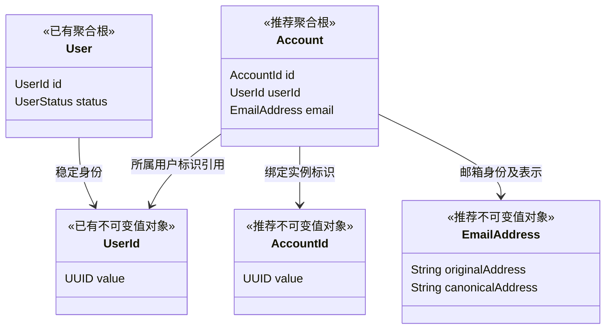
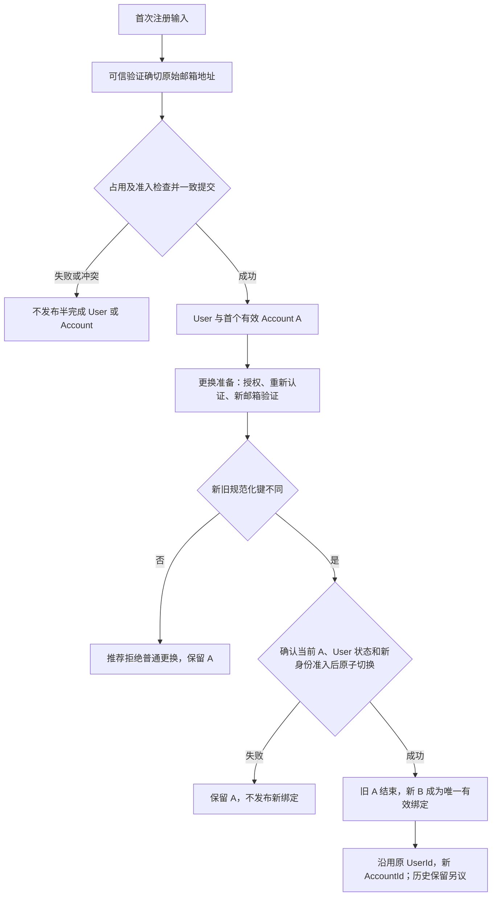

# Pikdo Email Account 领域决策（I2-0）

## 1. 背景、目标与设计状态

本文承接 [Identity 领域设计（I0）](3.identity-domain-design.md)，收敛第一版邮箱身份的 Account 模型，为后续 I2 纯 Java 实现提供评审依据。Pikdo 当前优先服务个人自媒体用户，以 UserId 表达个人业务数据归属；未来团队 SaaS 不在本阶段建模。

调查基线为 HEAD `903c04ae732ffa635e8e1870f22f5877ab98899d`，初始工作区干净，本文此前不存在。已阅读根 AGENTS、根与 Server README、完整 I0，以及 I1 的 User、UserId、UserStatus、包级空值约定和领域测试。I1 已有非空 UUID Record UserId，以及创建 ACTIVE、禁用、恢复、重复操作幂等的 User；本文不修改它们。

本文只新增设计文档，不交付 Account 代码、注册登录、认证或持久化能力。根及 Server README 对用户模型的描述尚未反映 I1，定位仍偏商家运营；以实际 I1 和本次任务的个人用户定位为准，相关文档调整另行处理。

| 标记 | 含义 |
| --- | --- |
| 已确认 | 本次产品决策或已有 I1 契约；后续实现必须遵守 |
| 推荐 | 本文选择的设计主线；须在 I2 或相关用例评审中批准后实施 |
| 待决策 | 尚有实质产品或技术选择；第 13 节明确其阻塞范围 |

推荐方案在图、场景和实施草案中保持一致，但图示不使推荐自动成为批准需求。完成本文不代表允许直接实施 I2。

## 2. 已确认的产品决策与 I0 映射

**已确认：** 第一版只针对 EMAIL 建模；密码与验证码尚未二选一，也可能经后续评审组合使用，但它们是同一邮箱身份的认证方式，不是两个 Account。不提前支持手机号、第三方身份或通用提供方框架。

**已确认：** Pikdo 将 ASCII 邮箱本地部分和域名均按大小写不敏感比较。例如 `Alice@Example.COM` 与 `alice@example.com` 是同一 Pikdo 邮箱身份。这是产品策略，不是对所有邮件服务器投递行为的断言。

**已确认：** 保留实际完成可信验证的 `originalAddress` 和按上述规则派生的 `canonicalAddress`。规范化不替代验证，不删除点号、`+tag`，不合并不同域名或服务商别名。

**已确认：** 第一版注册只建立一个有效邮箱 Account，不提供额外绑定或独立解绑最后一个邮箱。邮箱更换是受保护的单独流程，不改变 UserId。单邮箱是当前流程限制，不是永久的一对一领域结构。

| I0 决策 | 本次收敛与保留 | 是否阻塞 I2 纯模型 | 对真实功能的影响 |
| --- | --- | --- | --- |
| D-01 登录来源 | 已确认 EMAIL；认证方式待决策 | 来源不再阻塞；认证方式不阻塞 | 真实认证需先选择方式 |
| D-05 身份等价 | ASCII 大小写折叠已确认；格式范围、Java 相等实现推荐待批 | 后两项需在 I2 前批准 | 验证、投递不能只依赖等价键 |
| D-06 独立 AccountId | 推荐 UUID 值对象，标识一次绑定 | 需批准身份与表示契约 | 不负责全局邮箱唯一性 |
| D-07 AccountStatus | 推荐仅表达有效关联，不引入状态枚举 | 需批准生命周期表示 | 有效查询与历史分离须后续实现 |
| D-08 关联历史 | 推荐与有效集合分离；内容、目的、期限未定 | 不阻塞推荐的无终止态模型；若要求终止实体须重审 | 阻塞相关历史及邮箱释放策略上线 |
| D-09 最后身份保护 | 已确认不提供独立解绑；更换不得中途失去唯一绑定 | 不阻塞无解绑方法的模型 | 恢复例外及实际登录能力仍需设计 |
| D-10 重新绑定 | 推荐重新验证、授权、新 AccountId；跨用户重用未定 | 新实例语义需批准；重用策略不阻塞局部模型 | 阻塞邮箱释放、重用及恢复流程 |
| D-11 User 创建时机 | 已按本次注册场景收敛为验证后，与首个 Account 一致建立 | 不修改 I1 工厂 | 注册流程须保证一致提交 |
| D-13 标识表示 | UserId 已在 I1 确认；AccountId 推荐 UUID Record，生成外置 | AccountId 契约需批准 | 不选择生成设施 |
| D-14 User 状态 | I1 已实现 ACTIVE/DISABLED 及幂等行为 | 不再阻塞，不修改 I1 | 状态检查由未来执行边界落实 |
| D-15 绑定数量 | 第一版一个有效邮箱，无额外绑定 | 不阻塞单实例模型 | 应用与并发提交边界维护，不写进 User 集合 |
| D-16 禁用期间变更 | 推荐拒绝自助邮箱更换；恢复通道另议 | 不阻塞 | 更换权限及禁用竞争需实现 |
| D-17 可用身份 | 邮箱有效绑定不等于已有可用认证能力 | 不阻塞 | 阻塞正式认证及更换后的访问连续性设计 |
| D-18 认证上下文 | 解绑后不能凭旧关联重新授予身份；既有上下文失效时点未定 | 不阻塞 | 上线前必须明确生效边界 |

以上只收敛邮箱第一版，不重写 I0 的历史推荐，也不批准手机号、OIDC、团队等未来能力。

## 3. 术语与领域边界

| 术语 | 统一含义 |
| --- | --- |
| Identity | 管理平台用户与登录身份规则的领域模块，不是额外实体 |
| User / UserId | 平台长期用户主体及其稳定业务标识；所有权使用 UserId |
| Account | 某个邮箱身份与某个 User 的一次有效绑定实例；不是企业、订阅或第三方内容账号 |
| AccountId | 推荐用于区分绑定实例的不可变标识，不等于邮箱或 UserId |
| EmailAddress | 邮箱表示及 Pikdo 身份比较值，不是验证证明或凭据 |
| originalAddress | 该值保留的输入拼写；进入有效绑定时必须与实际可信验证的收件地址一致 |
| canonicalAddress | 从 originalAddress 派生的规范化身份键，只用于身份比较与定位 |
| 有效邮箱绑定 | 可信验证及一致提交成功、尚未结束的关联 |
| 邮箱身份等价 | 两个 canonicalAddress 相同；不证明相同实际收件人或操作者 |
| 邮箱归属验证 | 可信流程确认操作者控制指定原始收件地址；不自动证明其有权操作既有 User |
| 认证凭据 | 密码、验证码、Token 等认证材料，由未来认证设施处理 |
| 邮箱更换 | 针对同一 User，以新绑定原子替换旧绑定的受保护流程 |
| 重新绑定 | 已结束的邮箱身份再次满足准入条件后建立新关联；推荐不复活旧实例 |

语法合法的 EmailAddress 可以先在内存中构造，但不能因此声称邮箱已经验证。只有可信流程才可将它用于有效 Account。不会再建立与 Account 重复的 LoginIdentity 实体。

## 4. EmailAddress 规范化、支持范围与相等性

### 4.1 表示与派生规则

**已确认：** 身份等价依据是 canonicalAddress；originalAddress 保留实际验证的拼写。推荐只接收一个原始地址输入，由值对象派生规范化键，禁止调用方分别传入两个任意字符串，避免形成不一致表示。

**推荐：** 对支持范围内的 ASCII `A` 至 `Z` 逐一映射为 `a` 至 `z`，其余字符保持不变，不受运行环境 Locale 影响。originalAddress 不参与折叠或修饰。规范化应确定、幂等；域名与本地部分采用同一已确认大小写策略。

| 输入比较 | Pikdo 身份结果 | 限制 |
| --- | --- | --- |
| `Alice@Example.COM` / `alice@example.com` | 相同，键为 `alice@example.com` | 不允许据此替换可信收件目标 |
| `alice.smith@example.com` / `alicesmith@example.com` | 不同 | 不去点 |
| `alice+news@example.com` / `alice@example.com` | 不同 | 不去标签 |
| `alice@example.com` / `alice@example.net` | 不同 | 不合并域名 |
| 相同地址在不同系统语言环境下输入 | 键保持相同 | 不使用随 Locale 变化的转换策略 |

### 4.2 第一版最小格式范围（推荐，待批准）

这是一套有限的产品接收规则，不是完整邮件标准校验器，也不证明地址存在、可投递或已归属。所有规则及边界值需在 I2 前评审确认。

| 部分 | 推荐支持与拒绝规则 |
| --- | --- |
| 总体 | 非 null，单个地址，恰好一个 `@`，两侧非空；拒绝任何空白、控制字符和非 ASCII 字符 |
| 首尾空格 | 拒绝，不静默 trim；调用方不能把经修饰的地址冒充原始已验证地址 |
| 本地部分 | ASCII 字母、数字及 `!#$%&'*+-/=?^_`、反引号、`{`、竖线、`}`、`~` 组成非空段，段间可有单个点；拒绝首尾点和连续点 |
| 域名 | 至少两个非空标签，以点分隔；标签仅 ASCII 字母、数字、连字符，首尾为字母或数字；拒绝连续点、尾点、下划线、IP 字面量 |
| 长度 | 推荐本地部分最多 64 个字符、域名标签最多 63 个、完整地址最多 254 个；这是拟采用的产品输入上限，待批准，不据此宣称覆盖全部标准 |
| 复杂表示 | 拒绝 quoted local-part、注释、展示名与尖括号地址、地址列表及转义形式 |
| 国际化 | 延后 Unicode 本地部分、SMTPUTF8 及 Unicode 域名转换；不自动执行 IDNA 或 Unicode 规范化 |
| ASCII 域名中的 `xn--` 标签 | 可按普通 ASCII 标签规则接收，但不做解码或 Unicode 等价合并，不证明其 IDNA 有效性 |

例如 `alice+news@example.com`、`a.b@sub.example.com` 可通过上述语法；` alice@example.com`、`alice@example.com `、`a..b@example.com`、`"alice"@example.com`、`Alice <alice@example.com>`、`用户@example.com`、`alice@例子.com` 均拒绝。语法不接受的输入不通过猜测或网络探测自动修正。

### 4.3 Java 相等性方案比较

| 方案 | 语义与收益 | 代价与边界 |
| --- | --- | --- |
| A：自定义 EmailAddress 相等 | equals/hashCode 只比较 canonicalAddress，直接符合邮箱身份等价；无需新增键类型 | 相等对象可以保留不同 originalAddress；身份相等不意味着所有可观察表示相同，不能用相等对象替换可信收件表示 |
| B：表示与身份比较分开 | 完整表示比较保留两个字段，身份比较显式使用 canonicalAddress | 调用点容易误用默认 equals、集合去重或 Map 键；须明确所有身份判断接口，不必因此新增键值对象 |

**推荐 A：** 使用不可变普通类，将 originalAddress 与派生的 canonicalAddress 封装，自定义相等及 hashCode；不为双字段 Record 的默认行为增加歧义。B 仍是可评审替代方案。

两种方案都必须实现“身份等价依据 canonicalAddress”。未经批准不得将双字段 Record 默认 equals/hashCode 当作身份比较。方案 A 的相等性尤其不能用来认定原始收件地址调整已经获得授权；必须显式读取并保护绑定中保存的原始表示。

## 5. 可信验证及大小写碰撞安全边界

`Alice@example.com` 与 `alice@example.com` 在 Pikdo 是同一身份键，但实际邮件系统可能把它们投递给不同收件人。产品策略因此会压缩身份空间：一方已占用规范化键时，另一原始拼写不能再注册独立 Pikdo 用户。该限制不能通过自动合并、转移或更改原始地址消解。

| 情形 | 必须保留的安全边界 |
| --- | --- |
| 首次邮箱验证 | 验证必须针对确切原始地址及本次用途，证明不能由客户端 `verified=true` 等字段伪造 |
| 已存在 canonicalAddress，新注册者控制其大小写变体 | 即使变体验证成功，也不能创建第二归属、替换收件目标或获得原 User 的访问权 |
| 登录输入是已绑定地址的大小写变体 | 可以定位候选绑定，但输入不是认证；若通过邮件认证，发送目标必须来自绑定中的可信 originalAddress，而不是请求中的变体 |
| 找回、重置及敏感通知 | 使用可信已验证的收件地址；不得让相等性比较悄悄更换目标 |
| 准备绑定新邮箱 | 新地址控制证明不替代当前 User 的授权与适当重新认证；证明须限定身份、操作目标和用途 |
| 邮箱被服务商重新分配 | 当前控制邮箱不证明操作者就是历史 User；恢复与邮箱身份重用需要单独审查 |

密码式认证不把 canonicalAddress 匹配当作密码已验证；验证码式认证不能把“控制任意大小写变体”当成“控制已绑定原始地址”。认证选择尚未确定，本文只定义信任边界，不设计验证码、密码或会话机制。

**推荐：** 未来验证结果与确切原始地址、操作目的及目标相关联；仅存储一个 canonicalAddress 的验证结论不足以证明可更换原始收件目标。有效期、防重放、凭据校验及敏感变更重新认证由未来应用和认证边界设计。

若对外处理重复注册或恢复请求，应避免暴露账号存在性和其他用户资料；具体 HTTP 响应与错误码不在本文决定。未认证请求不能只凭匹配结果得到 UserId 或访问权限。

## 6. Account 聚合模型与划分依据

推荐最小结构为 `AccountId id + UserId userId + EmailAddress email`，均非空且在同一实例中不可修改。Account 是聚合根，AccountId 和 EmailAddress 是值对象，UserId 直接复用 I1。

| 比较 | A：User 聚合内部实体 | B：独立 Account 聚合 |
| --- | --- | --- |
| 单邮箱第一版 | 一个 User 内维护绑定较直接，属于合理替代方案 | 比 A 多出跨聚合协调，不能以当前账号数量论证必要性 |
| 生命周期 | 邮箱变化会进入 User 聚合；仍须区分长期用户与绑定实例 | 更换可结束旧绑定、建立新实例，User 本身及 I1 不变 |
| 一致性 | 用户内约束可集中，但跨用户邮箱唯一性依然不能独自保证 | 用户内单绑定与跨用户唯一性均需应用及并发提交边界 |
| 后续多邮箱 | 需要 User 管理关联并考虑聚合加载范围 | 可以扩展关联流程，无需给 User 增加集合 |

**推荐 B：** 主因是用户身份连续性与邮箱绑定生命周期不同，不是为了拆文件或减少事务。收益值得承担显式协调责任；若后续业务证据改变，可以重审，不为形式完整性增加框架。

独立聚合仍处于同一模块化单体，不意味着独立微服务、立即创建 Repository 或持久化。Account 通过 UserId 引用用户，不持有 User 对象；User 无需新增 accounts 集合。Account 构造合法，不能证明 User 存在、邮箱已可信验证、当前仍有效或身份全局唯一。

图不要求对象导航、ORM 或额外类型，也不将当前单邮箱限制编码为永久一对一结构。UserStatus 已存在，未在图中展开。

## 7. AccountId 的身份与表示

**推荐：** AccountId 使用非空 UUID Record，按 UUID 值相等，不负责生成 UUID，不增加 parse、random 或存储映射辅助方法。生成唯一性由未来调用及基础设施负责，构造器不能证明全局唯一。

- UserId 标识长期用户，邮箱更换、禁用、重新绑定都不改变它。
- AccountId 标识一次绑定实例。更换成功后，新邮箱绑定使用新 AccountId。
- EmailAddress 表达邮箱身份等价，不等于不可复用的实体身份。

独立 AccountId 能区分多次绑定和关联历史，避免以可更换、可重新分配的邮箱当实体标识；代价是多一种标识及其生成、引用责任。以邮箱或 UserId 加邮箱为替代标识可减少类型，但会混淆绑定实例与身份复用，也增加历史关联歧义。

AccountId 不用于业务数据所有权。仅持有它也不证明请求具备操作权限。推荐不为 Account 重写 equals/hashCode，业务实例身份由 AccountId 明确表达；这项 Java 实现约定在 I2 前一并评审。

## 8. 生命周期、有效集合与邮箱更换

### 8.1 不引入 AccountStatus 的推荐主线

Account 表达已经成立的有效邮箱关联，不把待验证输入、挑战过期、User 禁用等混入状态。验证中不是 Account，邮箱更换中的准备阶段也不是旧 Account 的状态变化。

应用及持久化边界维护有效集合：关联结束后退出有效集合，登录识别只读取当前有效关联。历史可以按未来策略独立记录，不意味着必须物理删除，也不意味着需要保留带 UNBOUND 状态的同一实体。

内存中的旧 Account 可能继续存在，但不能用于证明当前关联；认证或授权不能绕过有效查询直接信任旧对象。重新绑定推荐新建 Account 与 AccountId，不复活旧实例，不复用旧验证证明。

### 8.2 更换的提交边界

**推荐：** 操作者具备当前 User 的合法资格，User 为 ACTIVE，完成适当重新认证，并可信验证新原始地址后，才能尝试更换。新身份需满足全局未占用及未来邮箱重用准入规则。

原关联保持有效直到切换成功。提交边界应同时确认用户状态、当前原绑定仍是本次预期实例、新邮箱可用，并一致地结束旧关联与建立新关联。提交前旧绑定有效；提交后仅新绑定有效且引用原 UserId。失败不留下零绑定或双绑定，不以业务层先解绑再补绑来模拟切换。

新绑定必须具备产品认可的登录能力，不能仅验证了新地址就宣称访问连续性已得到保证；具体认证能力事实及其与切换的协调待认证方案确定。

旧关联结束后不能再据此重新授予登录身份；已建立的短暂认证上下文、进行中请求、失效时点及旧邮箱通知方式属于未来应用/认证设计，不由 Account 对象保证，也不在此声称立即撤销所有会话。

### 8.3 相同规范化键的地址变化

`Alice@example.com` 改为 `alice@example.com` 不改变 Pikdo 身份。**推荐：** 普通邮箱更换流程拒绝这种无身份变化请求，保留原绑定和原始收件目标，不分配新 UserId。

是否提供“调整原始收件地址”能力、需哪些额外证明、是否产生新 AccountId，均待决策；该能力不作为第一版已确认功能。即使 canonicalAddress 相等，也不能静默写入新拼写。若将来批准，必须兼容单个 Account 的 EmailAddress 不可变规则，不能随意增加 setter。

这是业务流程图，不是 Account 状态机；节点 C、T 中的查询与提交不能被拆成缺乏并发保护的多个成功步骤。验证阶段不存在 PENDING Account。图中的检查包含第 10 节要求，不选择具体数据库方案。

## 9. 业务不变量与责任边界

下表的“纯测”仅指后续 Java 领域单测。部分可测不表示完整流程已获证明；违反局部输入契约应拒绝构造，违反流程条件应拒绝提交或返回冲突，不引入本次 Web 错误码。

| 编号 | 业务含义 | 对象自身保证 | 未来应用责任 | 未来持久化及并发责任 | 纯测 |
| --- | --- | --- | --- | --- | --- |
| E-01 | AccountId 非空且不可变 | AccountId 与 Account 构造、只读属性 | 提供合法标识 | 标识引用及生成唯一性 | 局部可测 |
| E-02 | 所属 UserId 非空且不可改写 | Account 只读引用 I1 UserId | 确认目标用户存在及操作权限 | 注册同次建立或引用存在性；竞争一致提交 | 局部可测，不能证明用户存在 |
| E-03 | 同一 Account 的 EmailAddress 不可变 | 不可变邮箱值和只读字段 | 变更使用新绑定，不绕过流程 | 防止旧实例被覆盖为另一个绑定 | 局部可测 |
| E-04 | 同一有效 canonicalAddress 最多一个有效绑定、最多归属一个 User | 只能提供确定的身份等价 | 所有注册、更换、重绑统一执行占用规则 | 防止跨请求及跨进程重复提交 | 否，值比较仅部分可测 |
| E-05 | 第一版注册成功用户有且仅有一个有效邮箱绑定；更换后仍为一个 | 单个 Account 不能保证数量 | 不开放额外绑定、独立解绑；协调用户内切换 | 同用户并发变更不得生成零个或多个有效绑定 | 否 |
| E-06 | 原始地址与身份键职责分离且派生一致 | 拒绝无效输入、派生 canonicalAddress，按批准策略比较 | 邮件目标取已验证原始值，不以相等替换表示 | 一致保存有效绑定的原始值和身份键 | 派生及相等可测，可信性不可测 |
| E-07 | 有效绑定前必须可信验证确切原始地址 | 构造器及字符串无法证明验证 | 验证来源、目的、目标及适用性，拒绝伪造标记 | 不发布验证未成立的有效关联；一致消费验证事实的方式后定 | 否 |
| E-08 | Account 不保存密码、验证码或 Token | 最小字段与依赖边界 | 将凭据留在认证设施，不混入构造参数或输出 | 凭据存储不属于 Account 模型 | 模型边界可审查，流程需另测 |
| E-09 | 禁用保留绑定和历史数据，不自动授权访问 | I1 仅变更 User 状态 | 不自动解绑、删除；认证授权检查状态 | 提供可信状态可见性，协调更换竞争 | I1 局部状态已测，整体否 |
| E-10 | 邮箱更换保留 UserId，新绑定用新 AccountId | 单实例字段不可改；不提供转移行为 | 新建实例沿用原 UserId | 原子结束旧关联并建立新关联 | 字段局部可测，切换否 |
| E-11 | 结束关联不能继续授予登录身份 | 旧对象不能自证当前有效 | 读取有效关联，落实旧上下文处理规则 | 有效查询排除已结束关联，定义读取生效边界 | 否 |
| E-12 | 大小写变体不能重复注册或接管既有用户 | canonicalAddress 确定且按其等价 | 不自动登录、合并、转移或改收件目标 | 同键争用最多一次有效提交 | 等价可测，安全流程及并发否 |
| E-13 | 更换失败不得丢失唯一有效登录身份 | 无独立 unbind 或可假装安全的计数方法 | 先准备新能力，再发起一致切换；不先拆旧绑定 | 任何失败保留完整原关联，成功才整体切换 | 否 |
| E-14 | 不允许未经授权转移邮箱所属 User | 同一 Account 不可改 UserId | 重绑需要新验证与授权，重用策略未批不自动放行 | 身份释放、重用与占用必须一致判定 | 局部不可转移可测，授权否 |
| E-15 | 商品、任务及历史归属始终使用 UserId | Account 不管理这些数据 | 相关业务模块执行可信身份与所有权检查 | 相关模块保持归属事实，不因邮箱切换迁移所有者 | 不属于 Account 纯测 |

E-05 的“一个”是第一版流程约束，不要求 User 保存账号计数，也不禁止未来经新规则扩展多个邮箱。有效绑定不保证凭据能力始终可用，E-13 的认证能力事实仍受 D-17 约束。

## 10. 跨聚合与并发一致性要求

下列要求是未来实现的验收目标，不指定数据库、事务隔离级别、锁、索引或重试方案。

| 竞争或失败场景 | 允许的结果 | 禁止的结果与一致性要求 |
| --- | --- | --- |
| 两个注册流程争用相同 canonicalAddress，包括大小写变体 | 至多一个注册一致成功，其他流程冲突或失败 | 不能两者各建有效归属；失败流程不得发布孤立 User 或 Account，不能将冲突自动转成登录 |
| 同一发起者重复提交注册 | 同一可信流程按未来幂等设计返回同一已完成结果，或后续请求冲突；最终仅一个有效用户归属 | 注册前不能只凭自报 UserId 宣称是同一用户；不能因相同邮箱返回他人身份或跳过认证 |
| 更换目标邮箱与另一注册流程竞争 | 至多一方占用成功；更换失败时旧绑定完整保留 | 不能把已结束旧绑定作为让出新身份的代价，也不能同时形成两个有效归属 |
| 同一 User 同时将邮箱换成两个不同目标 | 推荐两请求针对同一预期原 Account 时至多一个成功；另一返回冲突，重新授权后可发起新流程 | 不能静默覆盖新绑定，不能最终保留两个有效邮箱；提交须确认原绑定仍是预期实例 |
| User 禁用与邮箱更换竞争 | 推荐形成明确提交先后：禁用先成功则拒绝更换；更换先成功则随后禁用，并保留新绑定 | 不得读取旧 ACTIVE 后在禁用生效之后仍作为合法更换提交；须协调状态与绑定提交顺序 |
| 更换中任一关联提交失败 | 整体失败、原绑定继续有效，或整体成功、仅新绑定有效 | 不得只结束旧关联、不建新关联，或新旧同时有效；未经整体成功不得对外宣称更换完成 |

注册的 User 与首个 Account 是一致建立边界；更换的旧关联结束、新关联建立、目标占用及原绑定条件是同一个一致切换边界。状态、权限及验证事实须在适用提交边界保持有效，不能仅在流程开始时检查。

简单的“先查无占用，再保存”允许并发请求都通过查询；单进程锁也不能证明跨进程正确。未来实现必须证明冲突判定与提交不可被其他相关操作绕过。邮箱身份全局唯一与用户内单绑定不接受暂时重复再事后修补的业务结果。

对提交结果尚不确定的请求，不得擅自报告成功或创建另一用户；未来应用层需依据权威结果处理。本文不增加自动重试或恢复功能。

## 11. 业务场景与不变量对应

所有场景只定义规则，真实执行均待后续实现；注册、登录和更换不能以纯领域对象可构造为上线依据。

| 场景 | 前置条件及处理 | 成功结果 | 失败条件与边界 | 对应不变量 |
| --- | --- | --- | --- | --- |
| A 首次注册 | 选定认证方案；可信验证原始邮箱，满足占用及重用准入；创建 ACTIVE User 与引用它的 Account，一致提交 | 一个稳定 UserId、一个有效邮箱绑定，不隐含已签发会话 | 验证不可信、占用、准入不满足或任一提交失败，均不发布半完成注册；跨聚合流程 | E-02、04～08、12、15 |
| B 正常登录身份识别 | 可信认证针对正确身份及绑定；查当前有效 Account，读取 UserId 与 User 状态，由未来认证设施继续判断访问资格 | 允许的情况下得到原用户执行身份；资源访问另做授权 | 查到相同邮箱不构成认证；无绑定、认证不成立、DISABLED 或状态不可确认时不能正常授予访问；跨聚合读取 | E-06～09、11、12 |
| C 重复注册 | 目标 canonicalAddress 已有有效占用 | 不产生第二注册；经授权的原流程重复结果由未来幂等设计处理 | 不创建第二个有效 User，不转移既有身份、不修改可信收件地址；对外信息披露策略后定 | E-04、05、12、14 |
| D 更换邮箱 | 当前 User 有资格且推荐为 ACTIVE；重新认证、验证新地址；新身份无冲突，适用重用规则；按第 8、10 节切换 | 同 UserId、新 AccountId，原关联结束、仅新关联有效，数据归属不变 | 权限、认证能力、验证、状态、旧绑定条件、占用或提交任一失败，保留旧绑定；跨聚合原子流程 | E-02～07、10、11、13～15 |
| E 新旧规范化键相同 | 输入与旧邮箱仅大小写等价 | 推荐普通更换拒绝，保留原关联和原始地址 | 不静默改投递目标；是否单独支持原始表示调整及所需证明仍待决策，不因相等跳过安全检查 | E-03、06、07、12 |
| F 禁用用户 | 未来应用确认禁用资格，调用 I1 行为并提交 | User 为 DISABLED，绑定与历史保留；未来入口拒绝正常访问 | 未授权或提交冲突则失败；不宣称所有既有上下文即时撤销，竞争按第 10 节协调 | E-09、11、15 |
| G 解绑与重新绑定 | 第一版无独立最后邮箱解绑；更换可结束旧关联；将来重绑须重新验证、授权和满足占用、重用准入 | 推荐同一 User 重绑建立新 AccountId，UserId 不变 | 历史关联不构成当前登录权限；其他 User 使用释放邮箱的准入未定，不能只因无有效占用就自动允许 | E-04、05、07、10、11、13、14 |

第一版“一个有效绑定”与“仍有可用登录能力”必须分开判断。禁用保留绑定不表示允许登录，恢复 User 也不复活旧 Account 或已撤销凭据。更换后的实际登录能力衔接、旧邮箱安全通知及恢复路径须在对应功能上线前完成评审。

## 12. 未来演进与明确非目标

| 演进方向 | 需要重新明确的规则 | 当前不增加 |
| --- | --- | --- |
| 多个邮箱 | 数量限制、绑定授权、最后可用身份保护、并发变更及收件目标选择 | User.accounts、主邮箱标记、优先级 |
| 手机号 | 号码等价、作用域、重新分配及恢复 | PhoneAccount 或统一 Provider 框架 |
| OAuth/OIDC | 来源作用域与主体的身份语义；不能按邮箱自动合并 User | SDK、通用身份继承树或全提供方枚举 |
| 历史审计 | 目的、最小内容、保留期限、访问权与删除责任 | 审计实体、AccountStatus 或数据库结构 |
| 邮箱释放及恢复 | 当前控制权与长期用户身份的差异，防止身份接管；历史保留是否足以执行规则 | 自动重用、自动合并、仅凭历史记录恢复 |
| 注销及删除 | 状态、身份释放、分领域数据保留与法律产品要求 | DELETED 状态或用 DISABLED 代替删除 |
| 团队 SaaS | 个人与团队资源能否共存、迁移授权及历史访问权 | Tenant、Organization、Membership、Owner 抽象 |

Identity 不直接操作 Collection、Catalog 数据；它们与未来应用层根据 UserId 执行服务端所有权检查。AccountId 或 EmailAddress 不能替代业务所有者。Collector 继续是独立执行器，本文不修改其接口或增加用户能力。

本轮不创建 Java、Controller、Service、Repository、DDL、认证协议、密码或验证码处理、邮件发送、JWT、Session、数据库或 Spring Security 配置。不选择持久化机制，不增加业务 API 或错误码体系。

## 13. 待决策事项与阻塞范围

“阻塞 I2”指进入纯 Java 模型前需要批准的契约，不代表本文要求立即决定所有产品问题。推荐项尚未批准时不应直接编码。

| 编号 | 问题及可选方案 | 推荐处理与风险 | 阻塞 I2 纯模型 | 阻塞的实际能力 |
| --- | --- | --- | --- | --- |
| E-D01 | 邮箱密码、验证码或经评审的组合 | 暂不选定；同一邮箱仍为一个 Account，避免把认证方法建成重复身份 | 否 | 正式认证、恢复及更换后能力衔接 |
| E-D02 | 自定义相等或完整表示加显式身份键比较 | 推荐第 4.3 节 A，批准后固定 equals/hashCode；相等不能授权替换原始值 | 是 | 所有邮箱比较与身份定位 |
| E-D03 | 邮箱支持格式、空格处理与长度上限 | 推荐第 4.2 节有限 ASCII 范围、拒绝不支持形式；存在拒绝部分真实邮箱的产品代价 | 是 | 邮箱输入与实际邮件能力支持范围 |
| E-D04 | 独立 AccountId 及表示 | 推荐非空 UUID Record，生成外置；代价为增加实例标识管理 | 是 | 关联实例追踪及更换引用 |
| E-D05 | 聚合与关联终止表示 | 推荐独立不可变 Account、无 AccountStatus；历史与有效集合分离 | 是 | 未来有效查询及一致切换 |
| E-D06 | 同键原始拼写变化：拒绝、独立验证调整、其他恢复流程 | 推荐普通更换拒绝；独立能力是否提供、证明要求、AccountId 行为未定，不能静默更改目标 | 否，若 I2 保持 EmailAddress 不可变且无更换方法 | 原始表示调整功能；普通更换需批准拒绝策略 |
| E-D07 | 历史不保留、最小审计、可查询终止实体及期限 | 推荐分离有效集合与历史；具体内容期限待定；如选终止实体须重审无状态方案 | 不阻塞推荐主线；改变实体语义时重审 | 邮箱释放、历史查询及正式更换的记录策略 |
| E-D08 | 释放邮箱仅原 User 重绑、允许其他 User 重用、按来源限制 | 不预设放行；同 User 重绑推荐新验证、新 AccountId。依赖历史的限制必须有相应事实支持 | 否，重绑新实例语义需随 E-D05 批准 | 正式注册、更换和重绑涉及历史释放邮箱的准入 |
| E-D09 | 无法访问旧邮箱时的恢复方式 | 另行定义可信恢复资格，不能仅凭控制新邮箱、同键变体或自报 UserId 接管原用户 | 否 | 恢复和缺少旧邮箱时的更换 |
| E-D10 | 注销与数据删除 | 单独设计生命周期、数据责任与身份释放，不以禁用代替 | 否 | 注销、删除及相关释放能力 |
| E-D11 | 更换后既有认证上下文失效时点 | 必须明确进行中请求、缓存新鲜度及生效边界；不得无限信任旧关联 | 否 | 安全上线邮箱更换及旧上下文处理 |
| E-D12 | 更换资格、重新认证、原邮箱通知与新认证能力切换 | 推荐正常自助更换要求 ACTIVE、适当重新认证和新地址验证；通知与能力衔接具体策略待定 | 否 | 正式更换与禁用竞争规则 |
| E-D13 | 可用登录身份的权威事实 | 与 E-D01 联动，不以 Account 数量冒充凭据可用性；需协调能力变化 | 否 | 登录及防止更换造成失联 |
| E-D14 | 重复请求结果、对外账号存在信息及提交不确定性 | 安全前置条件不因幂等而省略；返回既有结果必须有可信关联，不借冲突授予访问 | 否 | 注册、更换与恢复的实际对外流程 |

AccountId、聚合、生命周期及 EmailAddress 的格式与相等契约批准后，可以进入 I2。密码或验证码未决定不阻塞纯身份关联模型，但绝不代表真实注册或登录可以交付。

## 14. I2 纯 Java 实施契约与验收依据

### 14.1 最小候选范围

仅在评审批准后，考虑在已有 `identity.domain` 中新增 Account、AccountId、EmailAddress 三种类型，沿用现有包级 `@NullMarked`。User、UserId、UserStatus 和 I1 测试保持不变，不创建空的其他层包。

| 类型 | 推荐实施契约 | 不能宣称保证 |
| --- | --- | --- |
| AccountId | UUID Record，运行时拒绝 null，默认值相等及 hashCode，不生成标识 | 全局标识唯一或有效关联存在 |
| EmailAddress | 不可变，拒绝 null 和不支持格式；保留原始拼写，内部派生规范化键；按批准方案处理相等性，不接收可互相矛盾的两字段输入 | 邮箱存在、可投递、可信验证、操作者权限 |
| Account | 普通不可变聚合类，非空 id、userId、email；推荐私有构造器及静态 create 工厂、只读访问器，不重写实体 equals/hashCode | User 存在、邮箱已验证、绑定已提交、单邮箱数量或全局唯一 |

Account 工厂只建立满足局部契约的内存对象。它不是注册、验证或有效绑定持久化操作，不接收一个 `verified` 布尔值来假装证明可信性。正式有效 Account 的建立需要未来可信应用流程与一致提交；模型不能以命名或注释替代这些保证。

不提供原始邮箱 setter、用户转移、unbind、接收剩余账号计数的安全判断、Account 状态切换或复杂重建工厂。不提前加入时间审计字段、通用基类、事件框架或凭据类型。

### 14.2 后续测试边界

纯 Java 单测应使用现有 JUnit，不启动 Spring、数据库、HTTP 或邮件服务，至少覆盖：

- AccountId 的非空、值读取、相等与不等及 hashCode。
- EmailAddress 的原始拼写保留、大小写折叠、规范化幂等、Locale 无关、点和标签保留、域名不合并。
- 批准后的相等语义及集合键行为：同键不同拼写如何比较、原始表示仍各自保留。
- 第 4.2 节批准的合法/非法格式、空白、控制字符、复杂及非 ASCII 输入，以及长度边界和边界外输入。
- Account 三个组成的非空、只读引用、不同绑定实例的标识区别，直接复用 I1 UserId。

更换创建新 Account 且沿用 UserId 可以作为构造示例测试，不能据此宣称已经完成原子切换。全局邮箱唯一、User 存在、可信验证、授权、最后登录能力及表中六类并发结果，必须留给未来应用、认证和持久化集成测试。

### 14.3 文档验收与停止点

本阶段检查章节、决策来源与标记、两张 Mermaid 图、身份等价、原始收件目标、更换生命周期、不变量与场景对应及 I0 映射。执行 `git diff --check`、`git status --short`、`git diff -- docs/`；未跟踪文档另行完整读取并检查编码、空白及内容，因为普通 diff 不会展示它。

没有运行代码或依赖变更，无需运行 Maven 或 Collector 测试。确认唯一新增文件为本文，I0、I1、Server、Collector、POM、已有测试及基础设施均不变。不自动 Commit，不 Push；完成 I2-0 后停止，等待评审，不实施 I2。
