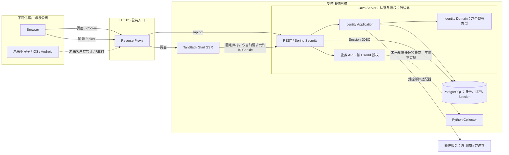
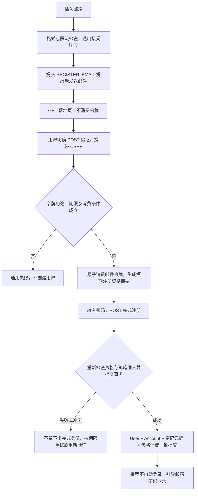
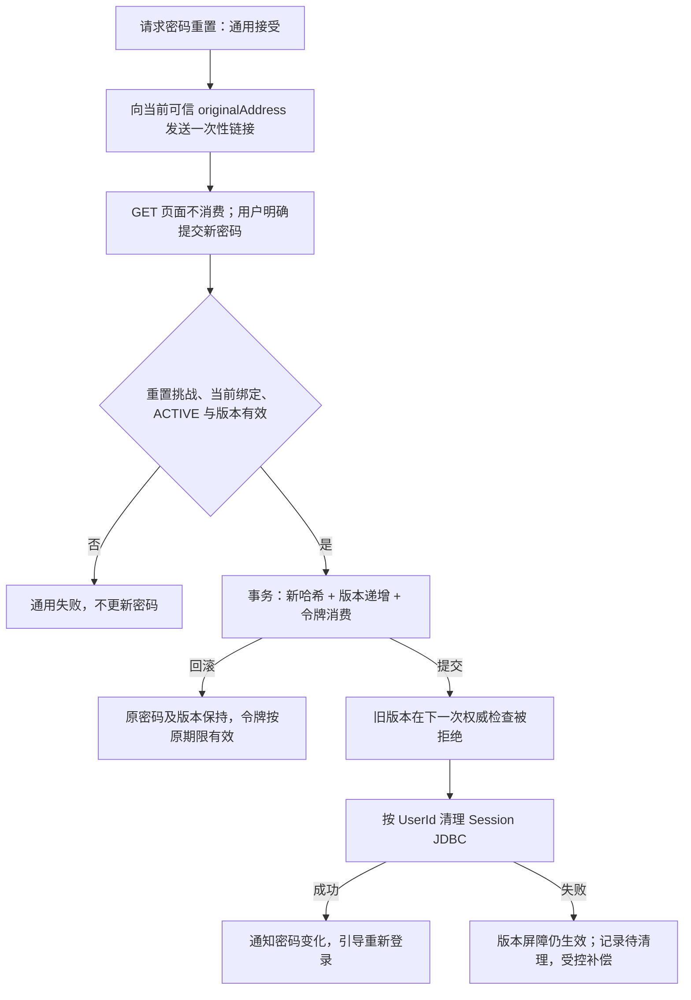
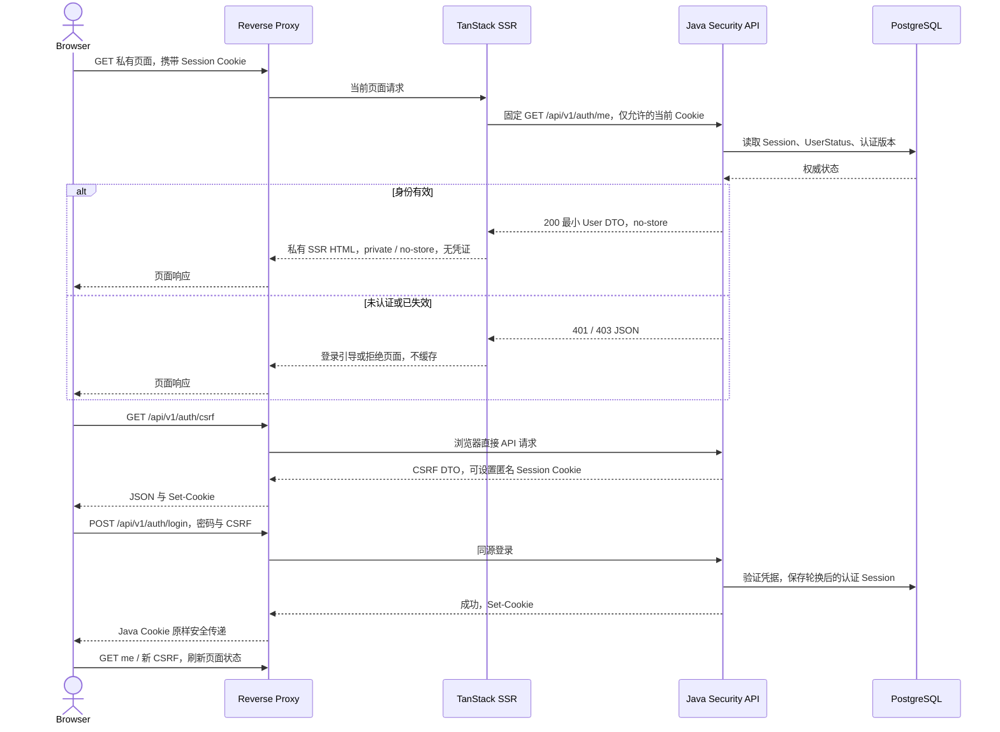

> 当前实现更新：本文保留原邮箱首版认证设计作为历史背景。Account 的邮箱专用字段和 user_id 单列唯一约束已由 Flyway V2 替换为 USERNAME/EMAIL/PHONE 登录身份（V3 新增 USERNAME）及按类型唯一约束；三类身份共享 UserId 下的一条密码凭据。当前另已补充独立不可变 PasswordCredential 领域对象及 Repository：create 初始化版本 0、restore 还原状态，按预期版本更新返回 boolean；仍不实现哈希算法、认证或 rehash。实际模型、查询接口和迁移兼容性以 [Server README](../server/README.md) 为准。本次只实现领域与持久化，本文的认证流程仍未实现。

# Pikdo Identity 认证与多客户端架构设计（I4-0）

## 1. 背景、目标与当前项目状态

Pikdo 当前优先服务个人自媒体用户，未来逐步支持多端与团队 SaaS。本设计以 Java Server 统一身份认证、业务授权和 REST API，TanStack Start 提供 Web SSR 与交互体验；个人业务数据始终归属于稳定 UserId，不提前建立租户或组织模型。

本文承接 [I0 领域设计](3.identity-domain-design.md)、[I2-0 邮箱 Account 决策](4.identity-account-decisions.md)及 [I3 验证报告](5.identity-domain-validation.md)，只定义后续实施方案，不代表认证系统已经交付，也不授权自动进入 I4-1。

### 1.1 仓库基线

| 项目 | 2026-10-20 实际核对结果 |
| --- | --- |
| Git HEAD | `0973ca7af08f69599f1c1532d4a525254651ea5f` |
| 初始工作区 | 干净；本文此前不存在 |
| I0、I2-0、I3 | 均已跟踪；I3 原文结论 PASS，并非尚未提交的推测 |
| Identity | 六个领域类型和包级空值约定均存在，本轮不修改 |
| Server | Java 21、Spring Boot 4.1.1、Maven Wrapper 3.9.15；已有 Web 基础设施 |
| Security / Session | 未引入 Spring Security、Spring Session 或认证 API，无既有登录 Session 实现 |
| 数据库 | 未引入 PostgreSQL 驱动、JDBC/JPA 持久化或 Flyway，无现成数据库配置 |
| Web | `web/` 已存在，为 TanStack Start SSR 模板，并非待创建的空项目 |
| Web 锁定版本 | Start 1.169.2、Router 1.170.44、Query 5.104.2、React 19.3.1、Vite 8.3.4、Node 22.23.2、pnpm 10.24.0 |
| Web 认证 | 尚未接入 Java；已有 Router、请求构造时建立的 QueryClient、流式 SSR 示例，无认证代理配置 |
| Collector | 独立 Python 执行器，当前没有 Java 用户、任务或登录集成 |

已阅读根 AGENTS、根及 Server README、完整历史设计与 I3、六个领域类型、POM、Server 配置、Web 清单与锁文件、Router、Context、SSR 示例及 Vite 配置。README 仍偏基础工程和商家定位，本文依据当前源码与本次个人用户优先的目标；不修改旧说明。

收口时 HEAD 为 `9c97c21e5491b8be575fb5762ad2f0b186a197bb`。期间出现工作区配置文件添加及移除两次提交，相对上述初始 HEAD 的文件净差异为空，未改变设计依据；本任务未执行 Commit 或 Push。

### 1.2 技术资料与版本可信度

本地 Boot 4.1.1 BOM 管理 `spring-security.version=7.1.1`、`spring-session.version=4.1.1`；它们是未来引入时的管理基线，不表示当前已经安装认证能力。Spring 官方指定版本入口可能重定向到滚动 Reference，实施时仍须按 BOM 再核对 API、默认行为和迁移脚本。

TanStack 通过官方 v1 文档与本地锁定依赖源码双重核对。Start 的子包并非都等于顶层版本：当前 start-client-core 为 1.170.37，start-server-core 为 1.169.43。不能凭顶层版本猜测全部导出，也不把本轮源码核对当成 SSR 集成测试已经通过。

| 官方资料 | 本文使用范围及版本限制 |
| --- | --- |
| [TanStack Execution Model](https://tanstack.com/start/latest/docs/framework/react/guide/execution-model)、[Server Functions](https://tanstack.com/start/latest/docs/framework/react/guide/server-functions) | 双端 loader、服务端函数与内部 RPC；v1 滚动文档，配合锁文件核对 |
| [Environment Functions](https://tanstack.com/start/latest/docs/framework/react/guide/environment-functions)、[Middleware](https://tanstack.com/start/latest/docs/framework/react/guide/middleware)、[Authentication Server Primitives](https://tanstack.com/start/latest/docs/framework/react/guide/authentication-server-primitives) | 服务端边界、请求上下文与同源保护；不是采用其独立 Session 的建议 |
| [Router Authenticated Routes](https://tanstack.com/router/latest/docs/framework/react/guide/authenticated-routes) | 页面保护与上下文，不替代 Java 授权 |
| [Spring Security CSRF](https://docs.spring.io/spring-security/reference/servlet/exploits/csrf.html)、[Session Management](https://docs.spring.io/spring-security/reference/servlet/authentication/session-management.html)、[SecurityContext Persistence](https://docs.spring.io/spring-security/reference/servlet/authentication/persistence.html) | CSRF 生命周期、固定攻击防护及认证持久化；具体配置在 I4-2 以 7.1.1 验证 |
| [Spring Session JDBC](https://docs.spring.io/spring-session/reference/configuration/jdbc.html)、[Boot Session](https://docs.spring.io/spring-boot/reference/web/spring-session.html) | 会话存储、主体索引和事务边界；以 4.1.1 脚本及实际行为复核 |
| [OWASP Authentication](https://cheatsheetseries.owasp.org/cheatsheets/Authentication_Cheat_Sheet.html)、[Password Storage](https://cheatsheetseries.owasp.org/cheatsheets/Password_Storage_Cheat_Sheet.html) | 认证失败、密码与哈希风险 |
| [OWASP Forgot Password](https://cheatsheetseries.owasp.org/cheatsheets/Forgot_Password_Cheat_Sheet.html)、[Session Management](https://cheatsheetseries.owasp.org/cheatsheets/Session_Management_Cheat_Sheet.html)、[CSRF](https://cheatsheetseries.owasp.org/cheatsheets/Cross-Site_Request_Forgery_Prevention_Cheat_Sheet.html) | 恢复、凭证生命周期与浏览器威胁 |
| [NIST SP 800-63B-4](https://pages.nist.gov/800-63-4/sp800-63b.html) | 第 3.1.1 节密码参考；本文不宣称已完成某个 AAL 的合规认证 |
| [PostgreSQL 约束](https://www.postgresql.org/docs/current/ddl-constraints.html)、[部分索引](https://www.postgresql.org/docs/current/indexes-partial.html) | 并发唯一性与历史方案比较；当前官网示例版本不是项目已选数据库版本 |

上述官方资料于本次设计核对。个别历史教程式 URL 不可访问时，使用仍可访问的官方章节和锁定源码，不引用不可访问页面来证明 API。

## 2. 已确认、推荐与待决策

| 状态 | 本文含义 |
| --- | --- |
| 已确认 | 项目方在本次任务明确批准，或 I1/I2 已批准契约，不再作为任意选项 |
| 推荐 | 本文选择的可评审主线，包括参数及实现机制；不等于项目方已经批准 |
| 待决策 | 存在必须保留的选择或风险接受；第 19 节说明阻塞阶段 |

### 2.1 已确认前提

- 第一版邮箱加密码登录；注册验证及忘记密码分别使用一次性邮件令牌。不把这些令牌用作长期登录凭据，不实现邮箱验证码免密、手机号或第三方登录。
- 保持已有 EmailAddress 的有限 ASCII 格式、大小写规范化、原始表示保留与值相等。相等不证明实际收件人相同或操作已授权。
- Account 是邮箱绑定实例，UserId 是长期主体和业务所有者；现有六个领域类型不保存密码、Token、Session，也不因本轮设计而修改。
- Web 使用 Java Spring Security Session；TanStack Start 不维护另一套用户登录 Session，Router Guard 仅改善页面体验。
- Java REST 是跨端契约；未来非 Web 可以使用不同的可撤销凭证，但最终均映射为 UserId。不提前选定 JWT、Refresh Token 或 OAuth2 服务。
- 保持模块化单体，不新增微服务、Maven Module、通用 Provider 继承体系或多租户模型。
- I4-0A 已确认 A-D02：首版采用原生 MyBatis、MyBatis Spring Boot Starter、Mapper 接口、显式 SQL 和 Spring 声明式事务；领域对象与持久化记录分离。不采用 MyBatis-Plus、通用 BaseMapper/BaseEntity 或自定义 ORM 框架。

- I4-1A 已确认 PostgreSQL 18、Flyway 和 Testcontainers PostgreSQL 集成测试；具体部署、凭据与容量仍需按环境配置。Spring Security 和 Spring Session JDBC 不属于本阶段实施范围。

### 2.2 推荐主线摘要

数据库基础采用已确认的 PostgreSQL 18、Flyway、原生 MyBatis 和 Testcontainers PostgreSQL。其余推荐主线为 Spring Security、Spring Session JDBC；同源代理、HttpOnly Cookie 与同步 CSRF Token；注册成功不自动登录；凭据关联 UserId；密码重置/禁用采用权威状态与认证版本检查，加集中 Session 清理。

数据库基础选型已按 I4-1A 批准，其余推荐技术与参数仍按第 19 节分别批准；不能因此升级 Spring Session JDBC 的决策状态或宣称认证已经实现。尤其不能将邮箱作为恢复渠道的残余接管风险视作已经接受。

### 2.3 统一业务实体 ID 规范（I4-1B 已确认）

Pikdo 自行生成的新业务实体主键统一采用 [RFC 9562 UUIDv7](https://www.rfc-editor.org/rfc/rfc9562.html#name-uuid-version-7)。由 Java Server 应用边界调用 `shared.id.UuidV7Generator.generate()` 分配，再封装为 UserId、AccountId 等领域标识；领域对象、Mapper 与 Adapter 不自行发号。Java 使用 `java.util.UUID`，PostgreSQL 使用 `UUID`，API 使用标准带连字符的 UUID 字符串，不改变外部商品 ID、SKU ID 的原始格式。

外键和共享主键直接沿用所引用实体的 UUID，例如密码凭据的 user_id 沿用 UserId，不额外生成 ID。已有 UUIDv4 不重新生成，读取和还原不限制版本；不修改 V1 或领域类型来强制只接受 v7。Request ID 等非业务实体标识保持原有契约。

生成入口复用 [Java UUID Generator（JUG）5.2.0](https://github.com/cowtowncoder/java-uuid-generator/tree/java-uuid-generator-5.2.0) 的线程安全 `timeBasedEpochGenerator()`，不引入中心发号服务或自定义算法。UUIDv7 不是认证秘密，也不保证跨进程全局严格递增或零碰撞；唯一约束继续由数据库最终执行。单元测试验证版本、variant、字符串格式和有限样本唯一性，数据库测试验证 v7 往返及旧 v4 兼容，不将样本结果当作全局唯一性证明。

## 3. 四层职责与领域保护

| 职责 | 负责 | 不负责 |
| --- | --- | --- |
| Identity Domain | User 状态、标识与不可变邮箱绑定信息、EmailAddress 局部规则 | 哈希、邮件、验证资格、Session、数据库与 HTTP |
| Identity Application | 注册与验证协调、密码认证用例、状态资格、重置、事务及授权前置条件 | 直接把前端布尔值当作证明；把数据库竞态交给 Java 对象解决 |
| Infrastructure | PostgreSQL 映射及 Repository、密码适配器、邮件适配器、挑战存储、Session JDBC | 改变 User/Account 业务身份或将其改为 ORM 基类 |
| Web / Security | REST、SecurityFilterChain、认证上下文、Cookie、CSRF、失败响应及入口授权 | 替代业务模块对商品/任务的 UserId 所有权检查 |

这些是单体内的边界，不要求立即建立四套目录或接口。只在实际用例需要时增加适配与持久化对象，不生成空包。

密码凭据、认证版本、验证挑战和 Session 是应用/基础设施能力，不给 User 或 Account 添加相关字段。Spring Security principal 推荐只保存可持久化的 UserId 字符串、认证版本及时间信息，不序列化整个领域对象、passwordHash 或原始密码；成功认证后清除临时 credentials。

UserId 的服务器端解析来自可信 Authentication，不接受请求头、请求体或 Router Context 自报的 UserId 作为授权依据。资源路径中的 UserId 只是查询目标，必须与可信执行身份及业务规则核对。

## 4. API-first 与系统信任边界

Java REST API 面向所有未来客户端，响应不引用 React、Router 或 Server Function 类型。OpenAPI 继续作为 Java 契约来源；生产 Swagger UI 仍按现有配置关闭，后续可以从构建或测试环境产生契约产物。不在本轮创建 TypeScript SDK 或共享 packages。

Server Functions 是 Web 内部 RPC，可以调用 Java；它们不成为小程序或移动端必须理解的协议。第一版浏览器直接调用同源 Java API，SSR 只代理读取当前身份等必要操作，不将全部 REST 重包装成 BFF。

Collector 不接收用户密码、邮箱验证令牌或浏览器 Session，也不替 Java 判断资源所有权。虚线只表达未来边界，不表示已有连接。内部 Java 调用仍执行 Session 与用户状态检查，不能因来自 SSR 网络而跳过认证。

## 5. 邮箱验证与注册流程

### 5.1 三阶段注册（推荐）

1. **请求验证邮件：** 校验 EmailAddress 格式，按 canonicalAddress 做冲突定位与限流。对已占用与未占用地址返回相同的接受语义，不创建 User/Account，不返回 UserId。
2. **确认控制权：** 用户打开邮件落地页，再明确提交验证操作。Java 检查 REGISTER_EMAIL 挑战，将邮件令牌一次性消费并兑换短期注册资格；此时仍未注册。
3. **完成注册：** 提交资格和密码。重新检查期限、资格、邮箱准入及占用；一致建立 User、Account、密码凭据并消费资格。推荐返回成功后引导密码登录，不自动建立已认证 Session。

推荐注册资格为另一个 256 bit 随机不透明值，仅数据库保存其摘要，客户端短期保存在当前页面内存；不是 JWT、不是登录 Session、不是 UserId。有效期建议为兑换后 10 分钟且不晚于原验证挑战期限，两者取较早值。Web 可将其绑定到当前 Java 匿名 Session 的引用摘要，不能把任意客户端 sessionId 字段作为绑定依据；绑定方式在 I4-5 验证。

匿名 Session 仅用于 CSRF 和短期流程约束，仍由同一 Java Session 系统管理。它不代表用户已登录，也不是 TanStack 的第二套用户 Session。页面丢失资格或匿名 Session 过期时重新请求验证，不通过前端 `verified=true` 恢复资格。

图中的“邮箱可用”不是单个查询的结果，最终仍由数据库约束和事务确定。密码哈希与阻止列表检查应先完成，提交时再检查资格，避免在锁内执行长时间哈希；资格过期则不得因已经计算哈希而继续注册。

### 5.2 失败与重复请求

| 情形 | 推荐结果与执行边界 |
| --- | --- |
| 同一 canonicalAddress 并发注册 | 至多一个完整事务成功，其他冲突；失败方不留下孤立 User 或凭据 |
| 相同邮件令牌重复验证 | 至多一次兑换成功；不能重复签发资格。兑换响应丢失时重新请求邮件，不从摘要恢复明文资格 |
| 邮件发送失败或进程退出 | 不创建正式用户；挑战可过期或记录发送失败，用户按冷却规则重新请求 |
| 验证令牌或注册资格过期 | 拒绝继续；不能由客户端声称验证时间或延长有效期 |
| 验证完成但注册事务回滚 | User/Account/凭据及资格消费整体回滚；资格仍有效时可重新提交 |
| 注册响应超时但事务已提交 | 重复资格不得再创建身份，返回通用已不可用结果；客户端提示结果不确定，可尝试密码登录或重新验证，不自动新建第二用户 |
| 已存在账号请求注册 | 通用接受，不向请求者返回账号资料；不发放可操作旧 User 的注册资格 |
| 大小写变体碰撞 | 按同一键判定冲突，不改变旧绑定 originalAddress，不合并用户或授予旧用户访问权 |

注册提交提供的是一次资格至多成功建立一次身份，不保证重试返回相同 HTTP 结果，也不声称跨请求 exactly-once。此推荐避免为初版增加通用幂等收据系统；若产品需要无感恢复超时结果，另行评审只返回非敏感完成状态的机制。

多个独立挑战可以存在，但最终唯一性仍由注册事务决定。不建议未经认证的再次请求直接撤销另一流程已验证的资格，以免制造低成本拒绝服务；重发数量及并发挑战总量须受限。

## 6. 一次性邮件挑战机制

### 6.1 用途、秘密与状态

推荐最小用途为 REGISTER_EMAIL、RESET_PASSWORD，不建立通用领域继承体系。challengeId 是定位标识，不能替代随机秘密。使用系统安全随机数生成至少 32 字节秘密，传输为 Base64URL；数据库只保存摘要，推荐 SHA-256 用于这些高熵随机值，不能将该选择用于用户密码。

| 信息 | 推荐用途 |
| --- | --- |
| challengeId、purpose | 定位挑战并隔离注册与重置用途 |
| originalAddress、canonicalAddress | 保存确切目标和已派生身份键，不接受消费时任意改地址 |
| tokenDigest、expiresAt、tokenConsumedAt | 定位/校验秘密、限制期限和一次消费 |
| verifiedAt | 仅注册：记录成功验证事件，不等于注册完成 |
| registrationGrantDigest、grantExpiresAt、registrationCompletedAt | 仅注册：区分邮件令牌消费与最终资格消费 |
| userId、accountId、authenticationVersionSnapshot | 仅重置：绑定发出时的用户、当前有效邮箱关联及认证版本 |
| createdAt、发送状态与必要元数据 | 交付和滥用控制；不保存原始秘密、完整 Cookie 或邮件正文日志 |

推荐邮件验证期限 30 分钟，密码重置 15 分钟。期限来自可信服务器时间，数据库存 UTC；不依赖浏览器倒计时。用途、目标关联、过期与未消费必须在消费事务中共同判断。重置挑战不得兑换注册资格，注册资格不能用于登录或重置。

注册兑换在一个数据库事务内更新 tokenConsumedAt/verifiedAt 并存储新资格摘要；最终注册另一个事务消费资格。兑换响应若丢失，旧令牌不再次授权；这是明确的安全失败与重新发起边界，不假装摘要可恢复秘密。

### 6.2 邮件链接与扫描器

推荐固定公开基础 URL，例如 `https://app.pikdo.example/register/verify#challenge=...&token=...`。不得从未校验的 Host、Forwarded 头或请求参数拼接邮件目标。邮件供应商的点击追踪和第三方跳转改写需要关闭或专项验证，不能让其记录令牌。

- fragment 不随普通页面 HTTP 请求发送；页面只在浏览器读取它，立即通过 history.replaceState 清除地址栏，并暂存在页面内存。不把秘密放入 Router loader 数据、Query key、localStorage 或 SSR HTML。
- 页面设置 Referrer-Policy: no-referrer、no-store 和适当 CSP，避免第三方脚本、分析、广告与可携带秘密的外链。即使使用 fragment，也不能依赖它抵御 XSS 或恶意浏览器扩展。
- GET、HEAD、预取、SSR loader、组件挂载和链接预览均不消费令牌。需用户明确操作后才 POST；不能在页面加载时自动验证。
- Java、代理、APM、邮件适配器和异常处理不记录请求体秘密、密码、Cookie 或带秘密的完整 URL。用户自己复制邮件仍可泄漏秘密，不能宣称链接绝不泄漏。
- 有效期和单次消费限制泄漏后影响，但不是邮件来源真实性或当前 User 操作授权的替代品。

令牌生成、存储、消费与重放边界参考 [OWASP Forgot Password](https://cheatsheetseries.owasp.org/cheatsheets/Forgot_Password_Cheat_Sheet.html)；这里的双阶段注册资格为 Pikdo 推荐流程。

### 6.3 邮件交付及响应时间

挑战先提交，再交付邮件，不把 SMTP 调用放在注册事务中。推荐单体内有界、提交后邮件分发，使邮件供应商响应时间不直接形成已知/未知邮箱的明显响应差异；不引入外部任务队列，也不承诺持久化投递重试。

原始令牌仅在生成及发送期间的内存中存在。若进程在挑战提交后、邮件发送前退出，数据库没有可恢复的明文令牌，用户需受控重发。I4-5 必须验证该失败体验和发送容量。若将来要求可靠异步投递，应另行设计秘密保护与交付方案，不能直接把明文令牌放入数据库 outbox。

已知、未知、禁用或冷却中的邮箱请求采用相同公开接受语义和近似处理预算；不宣称实际网络、数据库路径恒时。全局发送不可用可使用统一服务错误，不能仅对存在账号返回供应商错误。通知邮件发送失败不回滚已经生效的密码变更。

## 7. 密码策略与凭据管理

### 7.1 首版策略（推荐，待批准）

| 项目 | 推荐 |
| --- | --- |
| 长度 | 15～128 个 Unicode 码点，完整处理，不按 Java UTF-16 code unit 错计或截断 |
| 字符 | 支持可打印 ASCII、空格及合法 Unicode；拒绝非法代理项与控制输入，具体边界随密码策略评审 |
| Unicode | 推荐明确采用 NFC 后计长及哈希，创建、登录、重置使用相同且版本化的规则，并在界面/协议中说明；不得无说明改变现有凭据处理 |
| 禁止的隐式处理 | 不 trim、不折叠大小写、不移除内部空格，不复用 EmailAddress 规范化 |
| 组合与周期 | 不强制大小写/数字/符号组合，不无理由周期修改；已知泄漏时要求安全更新 |
| 易用性 | 允许密码管理器和粘贴，不将防粘贴当安全措施 |
| 阻止列表 | 创建和重置时拒绝常见及已泄露密码；推荐本地维护数据，不把原始密码发送第三方；来源及更新机制待批准 |
| 请求保护 | 在昂贵哈希前校验长度及请求大小；推荐认证 JSON 请求上限 16 KiB，并配合并发与速率控制 |

长度、完整字符计数、阻止列表与组合规则参考 [NIST SP 800-63B-4 第 3.1.1 节](https://pages.nist.gov/800-63-4/sp800-63b.html)。NFC 不等于 trim 或大小写折叠，但仍是需明确批准的密码处理契约，不能静默添加到未来存量凭据。

### 7.2 哈希、版本与 UserId 关联

推荐 Argon2id，起始性能评估采用内存 19 MiB、迭代 2、并行度 1，使用库管理独立随机盐和编码格式，实际部署按峰值并发、内存及验证耗时测定后定参。[OWASP Password Storage](https://cheatsheetseries.owasp.org/cheatsheets/Password_Storage_Cheat_Sheet.html)

实际 Java 库、Spring PasswordEncoder 适配及可能的提供者依赖在 I4-2 验证，不因参考算法就假定 Boot 已提供所需实现。不得自行设计哈希算法，不降级为快速摘要或静默截断。

密码凭据以 UserId 为唯一主体，保存 passwordHash、创建/修改时间、算法与输入处理版本、authenticationVersion。编码中已有参数信息时不重复维护不一致字段；版本策略必须能识别旧算法并在成功验证后升级。

AccountId 更换不删除或迁移用户密码，现有 Account 类不新增 passwordHash。认证版本是凭据存储及安全执行元数据，不是 User/Account 的新领域属性。

参数升级与真正密码改变区分：同一密码的安全 rehash 可保留认证版本，但使用预期版本和旧哈希的条件更新，不能覆盖并发重置；重置或安全失效事件递增版本。密码校验后创建 Session 仍需重新检查权威版本及用户状态，不能验证旧密码后直接读取新版号码签发有效会话。

## 8. 登录、退出与 User 状态执行

### 8.1 登录

浏览器先初始化 CSRF，然后向 Java POST 邮箱和密码。Java 校验输入、限流，按规范化键定位当前有效 Account，以 UserId 加载凭据，通过适配器验证密码；ACTIVE、凭据版本和当前关联条件满足才建立正常认证。

未知邮箱、错误密码和不允许登录的用户对未认证请求采用统一失败语义；未知主体使用适当的等成本验证路径，限流先于哈希，避免用差异化错误或显著耗时暴露存在性。不得只凭 canonicalAddress 相同就通过登录。

认证接入 Spring Security 的机制必须调用适用的 SessionAuthenticationStrategy，并通过 SecurityContextRepository 正确保存认证；只设置线程内 SecurityContextHolder 不等于登录持久化。成功时轮换 Session ID、清除临时 credentials、清理登录前 CSRF 状态并重新获取 Token。[Spring 认证持久化](https://docs.spring.io/spring-security/reference/servlet/authentication/persistence.html)、[Session 管理](https://docs.spring.io/spring-security/reference/servlet/authentication/session-management.html)

认证 principal.getName 推荐为稳定 UserId 的 UUID 文本，便于主体索引和集中撤销，不使用邮箱或 AccountId。Session 中只保留最小安全主体、认证版本和时间，HTTP 响应不暴露哈希。

### 8.2 退出

POST logout 需要 CSRF；使当前 Java Session 服务端失效，清除 SecurityContext，以相同 Cookie 名称、Path 和安全属性清除浏览器 Cookie。默认只退出当前 Session，密码重置则失效该用户所有旧版本 Session。

客户端得到成功后清理身份、私有 Query 与 Router 缓存；失败时不能声称服务端已经退出。退出的业务效果幂等，不代表过期 Session 携带旧 CSRF Token 的重复请求必定得到相同状态码。

### 8.3 禁用与恢复

推荐每个受保护请求读取权威 UserStatus 和 authenticationVersion，不仅相信登录时的快照，不使用可能滞后的副本或无界缓存。DISABLED 不建立新正常 Session，既有 Session 在后续检查时被拒绝。无法取得权威结果时拒绝继续授权，并使用安全的统一服务错误。

未来禁用应用操作将 User 状态变化与凭据认证版本递增一致提交，再清理集中 Session。恢复只恢复 User 状态，不回退版本，因此清理失败遗留的旧会话不会因恢复而重新有效。此协调不放进 User.disable/restore 方法，也不增加缓存或事件框架。

已经通过检查的并发请求不会被普通状态赋值立即取消；敏感写操作须在提交边界重新确认所需状态/版本。具体先后由应用事务定义，不能宣称全网即时撤销已发出的数据或所有正在运行的操作。

## 9. 密码重置与账号恢复

### 9.1 重置流程（推荐）

1. 接收邮箱，校验格式及限流；已知和未知身份均返回通用接受响应，不返回 UserId。
2. 仅向当前 Account 保存的可信 originalAddress 发送邮件。请求者输入的大小写变体只能定位身份，不能替换发送目标。推荐对 DISABLED 不启动自助恢复，公开响应仍相同。
3. 重置挑战绑定 UserId、当前 AccountId、原始地址及发出时认证版本；用户 GET 落地页不消费令牌，显式提交新密码与 CSRF。
4. 完成密码策略及哈希计算后，事务重新检查用途、期限、未消费、当前有效关联、用户状态和认证版本，再更新密码、递增认证版本、消费令牌。
5. 提交后集中删除既有 Session，发送密码变化通知，不自动登录。其他旧重置挑战因版本不匹配也不得继续授权。

若事务回滚，密码、版本和令牌消费均回滚。若响应超时而已提交，不重复修改；用户可尝试新密码登录。重放返回通用不可用结果，不通过旧令牌查询用户资料。

### 9.2 撤销的一致性

Spring Session JDBC 默认使用 REQUIRES_NEW 事务，不能假定与密码事务自然原子。[官方 JDBC 事务说明](https://docs.spring.io/spring-session/reference/configuration/jdbc.html)

本推荐将“逻辑撤销”与“物理清理”分开：密码更新和版本递增在业务事务中形成屏障；后续受保护请求必须对比权威版本，所以 Session 删除失败、旧请求在结束时重新保存 Session 或多实例竞争都不能使旧版本重新授权。

Session 清理失败不得回退新密码或恢复旧版本，也不得报告物理删除已经完成。记录最小非敏感失败信息和待清理状态，采用受控幂等补偿或运维处理；是否需要持久化清理任务在实施阶段按实际可靠性需求评审，不提前引入队列。若无法实现和验证版本屏障，则在解决撤销原子性前阻止密码恢复上线，不能仅采用尽力删除。

### 9.3 邮箱重新分配的产品风险

**待正式批准：** 推荐允许把当前绑定 originalAddress 的控制权用作密码恢复手段，但这意味着邮箱服务商将同一地址重新分配给他人时，新持有者可能重置历史用户密码并访问其数据。保持原始拼写只能防止大小写变体改投递，不能解决同一原始地址重新分配。

最小缓解包括限流、短期单次令牌、禁止自动登录、全部旧会话逻辑撤销、变化通知、明确恢复资格与受控申诉，不以历史关联或新邮箱控制权自动合并/转移 User。这些措施不能消除重新分配风险，变化通知也可能发给同一新持有者。

接受条件应由产品方结合数据敏感度、用户预期和损失范围确认。未批准风险接受前不能开放以邮箱为唯一证据的自助恢复；可以继续 I4-1，但完整首版认证发布应等待批准或更强恢复机制。未来可独立评估恢复码、额外认证因素或人工恢复，不在本轮实现。

用户无法访问原邮箱时，第一版不承诺仅凭新邮箱或个人资料恢复。User 禁用不因密码重置而解除，状态恢复属于独立授权流程。

## 10. PostgreSQL 与持久化一致性

### 10.1 技术比较与推荐

| 方案 | 对当前模型的影响 | 本文判断 |
| --- | --- | --- |
| 原生 MyBatis | 显式 SQL、参数绑定与结果映射，由独立持久化记录承接数据库结果；需维护 SQL 与映射 | A-D02 已确认，首版主要业务持久化框架，使用 MyBatis Spring Boot Starter 集成 |
| Spring JDBC / JdbcTemplate | 支持显式 SQL 和 Spring 事务，需编写结果映射及数据访问代码 | 备选，首版不作为主要业务持久化方案 |
| Spring Data JDBC | 可减少部分 Repository 代码，需审查聚合保存及引用规则 | 备选，不默认重写现有不可变模型以迎合映射 |
| JPA / Hibernate | 映射生态成熟，也能实现复杂查询；需处理实体生命周期、代理及跟踪行为 | 可行，但不作为首版主要方案；如以后采用，持久化模型与领域分离 |

选型依据是未来身份持久化、任务并发领取、批量写入、PostgreSQL Upsert、去重、筛选分页及统计分析对显式 SQL 控制的需求，以及项目维护策略。不宣称 MyBatis 天然比 JPA 快，也不认为 JPA 无法复杂查询或 Spring JDBC 不支持事务。

调用边界为 Identity Application → Persistence Adapter → MyBatis Mapper → PostgreSQL。Adapter 负责领域模型与持久化记录的映射；Mapper 接口负责 SQL 执行、参数绑定与结果映射，不直接编排注册或密码重置。六个领域类型保持纯 Java，不增加 MyBatis、JPA 或数据库注解。

推荐复杂 SQL 和动态 SQL 优先组织为 XML Mapper；简单 SQL 是否用注解在具体实现时确定，不要求所有 SQL 使用 XML。Spring 声明式事务负责应用用例中多个 Mapper 操作的一致边界，不自行调用已由 Spring 接管的 SqlSession commit/rollback；数据库最终保证唯一性及引用完整性。

MyBatis 用于业务数据访问，不替代 Spring Session JDBC 的 HTTP Session 存储。Spring Session JDBC 仍维持原推荐；Flyway 和 PostgreSQL JDBC Driver 已纳入获批的数据库基础工程，三者分别负责会话、迁移和数据库连接；不批量移除 JDBC，也不改变 Session 的独立事务边界。

已确认 PostgreSQL 18 与 Flyway；本地开发优先复用已有 PG，Compose 仅提供可选新环境，真实数据库测试采用隔离的 Testcontainers PostgreSQL。部署、密钥、备份及容量按环境落实。Flyway 管理 Schema，I4-1A 只建立三张 Identity 核心表；Spring Session JDBC 尚未实施，未来采用时再纳入对应版本脚本，关闭框架自动初始化冲突。

Persistence Adapter 将 Mapper 返回的持久化记录通过既有 UserId/Account 工厂映射为领域对象；当前 DISABLED User 可由 create 后调用已有 disable 还原，当前行为没有事件或时间副作用。不能使用反射写 final 字段或给领域强加无参构造器；未来行为变化导致还原接口不足时另行评审。

I4-1 需使用真实 PostgreSQL 集成测试验证 Mapper 映射、唯一约束、外键、事务回滚与并发身份冲突。Testcontainers PostgreSQL 已确认为隔离集成测试方案，不以 Mockito 替代数据库约束验证；数据库基础由 I4-1A 实施，正式业务 Mapper 与 Adapter 留待 I4-1B。

### 10.2 概念存储

| 存储 | 关键字段与主键 | 引用及唯一性 | 事务、历史与删除边界 |
| --- | --- | --- | --- |
| identity_users | id UUID 主键、ACTIVE/DISABLED 状态及必要存储元数据 | id 为长期 UserId | 与首个绑定和密码一致建立；禁用不删除；注销待决策 |
| identity_accounts | id UUID 主键、user_id、original_address、canonical_address、必要绑定/验证时间 | user_id 引用 users；首版有效集合内 user_id 唯一、canonical_address 唯一 | 推荐首版仅存有效集合；不提供独立解绑或更换；历史保留和关联结束存储方案另议 |
| identity_password_credentials | user_id 主键、password_hash、创建/修改时间、算法/处理版本、authentication_version | user_id 引用 users，一个 User 的密码凭据不依赖 AccountId | 注册一致建立；密码更新与版本及挑战消费一致提交；不存在明文密码或密码历史功能 |
| identity_email_challenges | challenge_id 主键、第 6 节的用途、摘要、期限、消费及资格字段 | 重置引用 User/Account，注册前允许无 User 引用；秘密摘要需明确查找及防冲突规则 | 注册兑换/完成与重置分别有条件消费事务；期限、保留与清理策略待批准 |
| Spring Session JDBC 表 | 框架要求的 Session 主键、Session ID、时间、principal_name 及属性存储 | 主体索引使用 UserId 文本；结构以匹配版本官方脚本为准 | 与业务事务默认独立；不以级联删除用户替代显式撤销；过期清理由实施配置验证 |

密码与 Session 表仅基础设施访问，不暴露在 HTTP DTO。数据库访问和备份最小授权，Session 属性不能接受不可信数据库内容反序列化；滚动升级须验证会话属性兼容及失效策略。

### 10.3 身份唯一性与历史

canonicalAddress 使用明确的确定性比较，推荐 PostgreSQL 的 C 排序语义，避免数据库 Locale 或隐式 case-insensitive 类型改变已批准规则。原始与规范化地址保持 ASCII 派生一致，可用明确 ASCII translate 关系约束辅助；不能用不受控的 locale lower 替代 EmailAddress 业务规则。

最终并发唯一性由数据库保证，Java 的无占用查询只用于流程判断。UserId 唯一约束表达第一版一个有效邮箱，将来多邮箱必须经受控迁移调整，而不是放松应用检查后偷偷多写。

当前推荐 identity_accounts 只保存有效集合，唯一索引不表示已释放身份自动可重新注册。第一版不提供结束关联能力，因此不借本次选型确定未来删除/重用政策。若以后保留终止记录，可比较独立历史存储与 ended_at 加有效行部分唯一约束；后者是持久化元数据，不等于给 Account 增加 AccountStatus。两种方案都须先批准历史目的、期限和身份重用规则，再上线邮箱更换或释放。

### 10.4 注册与重置事务

注册事务须包含资格条件消费、User、Account、密码凭据建立，并在提交边界再次判定准入。对唯一冲突、资格已用和事务异常整体回滚，不自动合并或切换成登录。不能以检查后插入、单进程锁或最终一致修复容忍重复归属。

重置事务锁定或条件更新挑战与凭据，验证 User ACTIVE、当前 Account 与原始目标、用途、期限及认证版本；更新哈希和版本并消费令牌。两次并发重置至多一个以旧版本成功，另一个必须失败或重新发起。与登录、禁用及未来邮箱更换的竞争须定义一致提交先后，敏感提交不能继续使用过期状态。

Session 物理删除按第 9 节独立处理。不要为了少一个补偿边界就任意改写框架的事务传播；如果选择自定义传播，必须用真实数据库、请求结束保存和失败注入证明行为。

## 11. Spring Security 与 Session JDBC

推荐 Web 认证仅使用服务端 Session，不启用 Remember-me 或第一版 Bearer 凭证。Session 只在 CSRF 初始化或需要正常认证时创建；普通未认证 GET me 不为每次 SSR 请求创建匿名会话。

登录创建/更新认证后，应等待会话保存成功再把成功响应视作可用，验证 Session ID 轮换与旧 ID 失效。Session 存储故障不得降级到各实例内存登录态或悄悄放行。

Session 身份内容建议为 UserId、认证版本、authenticatedAt、可选 absoluteExpiresAt。空闲超时由会话存储管理；绝对上限由独立检查执行，滑动访问不能延长绝对期限。认证版本检查与集中 Session 持久化共同支持多实例，单机 SessionRegistry 不能作为完整撤销证据。

主体索引必须确实提取 UserId 的 principal name；I4-2 用两实例验证能查找并清理同一主体 Session。对请求结束保存、并发失效和过期清理都需真实行为测试，不仅检查配置存在。

用户状态及版本检查位于可信认证恢复后、业务授权前的 Security 执行链路，不散落在 Router 或每个 Controller。Security entry point、拒绝处理器、登录失败处理器均返回既有 JSON 形状，不默认重定向成 HTML 登录页。

## 12. Cookie、CSRF 与 Session 生命周期

### 12.1 环境参数推荐

| 项目 | 生产推荐 | 本地开发边界 |
| --- | --- | --- |
| 传输 | 公网 HTTPS；跨主机内部凭证传输使用受保护链路 | 同一 localhost 入口，受控本地代理到 Java；不将开发例外带到生产 |
| Session Cookie | `__Host-PIKDOSESSION`，HttpOnly、Secure、SameSite=Lax、Path=/、无 Domain | HTTP 时使用不同名字如 PIKDOSESSION，Secure=false，仅开发 Profile |
| Cookie 生命周期 | 默认浏览器会话 Cookie；服务端仍独立执行超时 | 不把浏览器关闭当作可靠服务端撤销 |
| 空闲超时 | 推荐 30 分钟 | 测试可缩短，但验证同一机制 |
| 绝对上限 | 推荐额外启用 24 小时；作为待批准业务约束 | 独立于空闲超时进行测试 |

`__Host-` 要求 Secure、Path=/、无 Domain，必须核对 Cookie serializer 和最终代理行为。本方案 Path=/ 是为了让页面 SSR 请求带上 Java Session；若仅设 /api，页面 SSR 就无法读到它。Host-only 不跨子域扩散，SameSite 的 site 概念也不等于同源，不能独自取代 CSRF。[OWASP Session Management](https://cheatsheetseries.owasp.org/cheatsheets/Session_Management_Cheat_Sheet.html)

### 12.2 同步 CSRF Token 推荐

采用 Spring Security 的 HttpSessionCsrfTokenRepository：浏览器通过 GET `/api/v1/auth/csrf` 取得 `{headerName, token}`，Java 可创建未认证 Session，Cookie 直接经代理到浏览器。前端只将 CSRF Token 放当前客户端内存，并按返回的 headerName 随后续 POST 提交，不需要读取 HttpOnly Session Cookie。

Token 必须来自 Spring 请求处理链暴露的 CSRF 对象；延迟加载及 XOR 掩码与回传解析保持一致，不能把 repository 的原始值与掩码处理器混用。I4-2 验证实际 7.1.1 行为，不通过关闭保护解决不匹配。[Spring CSRF](https://docs.spring.io/spring-security/reference/servlet/exploits/csrf.html)

- 保护登录、退出、注册验证与提交、重置确认，以及未来修改密码、邮箱和其他 Cookie 授权的状态操作。公开 permitAll 不等于忽略 CSRF。
- GET csrf 无需已有登录身份，响应 private、no-store；同源浏览器初始化，拒绝明确的跨站 Origin/Fetch Metadata，不开放跨源凭证读取。
- 登录及退出后旧 Token 失效，浏览器重新 GET csrf；SSR 首次页面只读取身份，水合后由浏览器初始化 Token。客户端导航复用当前有效 Token，状态变化后刷新。
- 403 不盲目重放 POST。先区分当前身份是否仍有效，必要时重新取 Token，等待用户明确提交；业务 Forbidden 不能误判为 CSRF 并自动重试。
- SameSite、JSON Content-Type 和 CSRF 各司其职；不对整个 `/api/v1/**` 关闭 CSRF，也不因未来移动端需要就创建浏览器豁免。

未来 Bearer 客户端若引入，按明确独立认证链和路径/匹配条件评审 CSRF 需求，不能让一个请求混用两套身份或通过可伪造标记绕过 Web 保护。

## 13. TanStack Start SSR 集成

### 13.1 核对后的能力及限制

| 能力 | 当前核对证据 | 在本设计中的用途 |
| --- | --- | --- |
| createServerFn | 官方 Server Functions；本地 react-start 根导出及 client-core 实现 | 在 SSR 内执行服务端 handler，在浏览器导航时调用内部 RPC；不是公共 Java API |
| createServerOnlyFn / server-only 模块 | 官方 Environment Functions；本地根导出和包导出项存在 | 保护内部 Java URL、请求 Cookie 读取及服务端适配，不是把普通函数自动变成 RPC |
| getCookie / getRequestHeader(s) | 官方 Authentication Server Primitives；本地 server 子路径导出链及 server-core 请求响应实现 | 从当前有效请求上下文读取 Cookie，不能在全局初始化时捕获 |
| createMiddleware / createCsrfMiddleware | 官方 Middleware；本地 client-core 与 Start handler 存在对应实现 | 保留 SSR/Server Functions 的请求边界及同源检查，与 Java CSRF 独立 |
| beforeLoad / loader | 官方 Router、Execution Model；本地项目已有路由 loader | 可能在 SSR 和浏览器执行，不能直接假定内部 fetch 永远留在服务端 |

不在文档给出未经执行的完整示例配置。文件名 `.server.ts`、构建保护与 server-only 工具应共同使用并验证客户端产物；仅把秘密放进名为 server 的普通模块不能证明不会泄漏。

当前锁定 Start 支持默认的 Server Function 同源保护；如果后续增加自定义 src/start.ts，必须显式保留适用的 CSRF 中间件，不能关闭警告来代替保护。浏览器侧请求这些 RPC 时仍需满足其 Origin/Fetch Metadata 规则，但 Java API 继续执行自己的 Session 和 CSRF 约束。

### 13.2 SSR 身份读取

1. 浏览器向公共页面入口发送 Java Session Cookie。
2. SSR 在当前请求作用域取出允许的 Session Cookie；不存在时可以直接按未认证处理，不调用创建会话的接口。
3. 服务端只向配置好的受信任 Java origin 和固定 `/api/v1/auth/me` 发起请求，显式设置所需 Cookie。服务端 fetch 的 credentials 选项不会自动继承浏览器 Cookie jar。
4. Java 恢复 Session，检查权威 UserStatus、认证版本和期限，返回最小 `{userId}` 或 401/403。
5. Web 根据结果渲染或执行安全的相对路径重定向，只把允许的用户 DTO 交给客户端。

SSR 不透传完整 Cookie、Authorization、自报 X-User-ID、任意 Host 或任意上游 URL。对内部 fetch 使用受控目标并禁止跨目标自动重定向；Java 异常返回 HTML 登录页/302 应视为配置错误，不能携带 Cookie 跟随到其他站点。

推荐 GET me 不创建或轮换 Session ID，正常读取无需转发新的 Session Set-Cookie；失效时由浏览器直接访问 csrf/login 端点更新 Cookie。如果未来 SSR 必须转发 Cookie 删除等响应，只能按明确白名单在响应头发送前处理，不能透传任意上游 Set-Cookie，也不能在流式输出开始后才补登录头。

图中 CSRF 初始化与登录是浏览器直接调用 Java，不经过 SSR 重包装。最小用户数据可以序列化用于页面展示，但 Session Cookie、密码、邮件令牌和完整 Authentication 永远不进入 HTML/loader payload。

### 13.3 Router 与数据缓存

SSR 必须在发送用户私有内容和响应头之前完成身份判断，不能先流出私有数据再重定向。当前 streaming 示例只是本地模拟，不能直接当作认证模板。

Web 的 getContext 已建立独立 QueryClient，但 I4-3/4 仍须证明每次 SSR 请求创建隔离的 Router/QueryClient。当前默认 staleTime 为 30 秒，不得据此全局缓存当前用户或在身份边界复用旧用户数据；身份查询可单独设定更新策略。

登录、退出、重置完成后清理旧身份及私有 Query、Router loader 缓存，取消旧请求并防止其晚到结果重新写回。私有数据 query key 以当前 UserId/客户端身份代次隔离；客户端代次仅控制 UI，不是 Java 授权证据。随后重新读取 me、刷新 Router Context，再决定导航。

推荐通过同源 BroadcastChannel 通知其他标签页清理/重验，不发送凭证或把通知当作已认证事实；重新聚焦和恢复页面时重验。清理本地 UI 不等于服务端撤销成功，也无法追回已经显示或被用户保存的数据。

## 14. 同源代理、环境部署与缓存

### 14.1 环境边界

| 环境 | 推荐入口 | 约束 |
| --- | --- | --- |
| 本地 | 浏览器固定使用一个 localhost Web 端口；Vite 将 /api/v1 代理至 Java 8080 | 不混用 localhost 与 127.0.0.1；SSR 配置固定内部 Java 地址；HTTP Cookie 例外仅开发 |
| 集成/E2E | 使用隔离数据库、邮件接收器和同源测试入口 | 另设生产等价 HTTPS 场景覆盖 Secure、前缀、代理及 SameSite，不能只靠 HTTP 测试 |
| 预发布 | 生产式 HTTPS 代理及独立域名/数据库/邮件凭据 | 禁止向非白名单真实收件人发送测试秘密 |
| 生产 | 如 app.pikdo.example，页面到 Web，/api/v1 到 Java，路径不重写为其他认证契约 | Java 与数据库不直接公开；管理、调试和 Swagger 路径不因代理通配而暴露 |

代理仅信任受控入口生成的 Forwarded 信息，清理客户端伪造头。Java 明确可信代理范围和公开 origin，不能用任意 Host 决定邮件链接、Secure 属性或 CSRF 允许来源。跨主机 Cookie 内部传输需保护，单机 loopback 与跨网络部署分别评审。

同源减少凭证 CORS、跨站 Cookie 和 SSR 环境差异，不等于不需要 CSRF。将来独立 API 域名或移动端接入时重新设计允许来源和凭证机制，不提前开放任意带凭证 CORS。

### 14.2 缓存分类

| 内容 | 推荐策略 |
| --- | --- |
| 纯公共页面/静态资源 | 只有与用户无关、无秘密的内容才可按公共缓存策略发布 |
| 未认证但含 CSRF、挑战或流程状态的页面 | private、no-store，不因未登录就当作公共内容 |
| 用户私有 SSR HTML | private、no-store，CDN/代理明确绕过，不依赖 Vary: Cookie 作为唯一防线 |
| me、csrf、登录/注册/重置及私有 API 响应 | no-store；成功和失败均不缓存用户相关或秘密内容 |
| SSR loader/Query 数据 | 每请求隔离，只序列化最小允许 DTO，禁止模块级当前用户缓存 |

SSR 内部 fetch 也不得经过共享身份缓存。登录/退出后失效客户端数据；浏览器返回缓存或 BFCache 恢复时重验，不能保证 HTTP no-store 可以替代所有浏览器内存状态管理。I4-4 用两个用户并发 SSR、导航和退出测试证明没有串号。

## 15. 小程序与移动端演进边界

| 候选 | 可取之处 | 必须重新设计的部分 |
| --- | --- | --- |
| 不透明可撤销 Token | 服务端查验与撤销清晰 | 存储、轮换、过期、设备丢失、请求频率及可用性 |
| Access + Refresh 凭证 | 可分离短期访问与长期恢复 | 是否不透明或 JWT、刷新轮换、重用检测、全部设备撤销，不把它等同于特定编码格式 |
| OAuth2/OIDC 标准流程 | 可处理公开客户端授权及身份来源 | PKCE、重定向、issuer/subject、系统浏览器与安全存储，是否需要独立授权服务 |

当前不选定任何方案，不创建 Token 实现。未来 Web Cookie、移动端凭据及小程序平台规则分别验证；成功后均由 Java 产生可信 UserId 上下文，并执行同一业务所有权规则。

第三方身份需可信来源作用域与 subject，不能按相同邮箱声明自动合并 User。现有 Account 为 Email-only，不提前扩成 Provider/Credential 继承树；实际增加新来源时重新评审领域模型。

Monorepo 当前已有 collector、server、web、docs；只有真实需求出现后才增加 miniapp、mobile、packages。统一 Java API 契约可以支持以后生成适用客户端，但不能机械共享 Web CSRF、Cookie 或凭据存储策略。不引入 Turborepo、Nx 或多包 SDK 工程。

## 16. Java Web V1 API 契约草案

以下均为推荐、待接口评审；路径统一以 `/api/v1` 为前缀。Java API、Start 内部 RPC 和 Router 页面路径是三种不同契约，不复用名称暗示认证能力已实现。

### 16.1 操作与响应

| ID | 方法与路径（省略前缀） | 请求 | 成功语义 | 已有登录 / CSRF |
| --- | --- | --- | --- | --- |
| A01 | POST /auth/registration-email-requests | email | 202 通用接受，不返回 UserId、秘密或账号存在状态 | 否 / 是 |
| A02 | POST /auth/registration-email-verifications | challengeId、token | 200 registrationGrant、expiresAt；不建立正式用户或认证 Session | 否 / 是 |
| A03 | POST /auth/registrations | registrationGrant、password | 204 一致完成注册；推荐不自动登录 | 否 / 是 |
| A04 | POST /auth/login | email、password | 204，Java 建立认证 Session、轮换 Cookie；客户端随后读取 me 和新 CSRF | 否 / 是 |
| A05 | POST /auth/logout | 无业务参数 | 204，当前 Session 失效并清 Cookie | 可为已过期状态 / 是 |
| A06 | GET /auth/me | 无 | 200 最小 userId；未认证 401，受禁用等约束时拒绝 | 是 / 否 |
| A07 | POST /auth/password-reset-requests | email | 202 通用接受；只向当前可信地址发送 | 否 / 是 |
| A08 | POST /auth/password-resets | challengeId、token、newPassword | 204，更新密码、消费挑战、旧版本失效；推荐不自动登录 | 否 / 是 |
| A09 | GET /auth/csrf | 无 | 200 headerName、token，可初始化 Java 匿名 Session | 否 / 初始化入口 |

这些 API 不接收可信 UserId、验证布尔值或单独 canonicalAddress 作为客户端授权输入。未来已登录修改密码或邮箱接口同样需要认证、适当重新认证和 CSRF，本轮不增加其正式 API。

### 16.2 限流、重复与失败

| ID | 重复/并发要求 | 主要失败及信息边界 | 推荐限流维度 |
| --- | --- | --- | --- |
| A01 | 可重复发起，但受冷却与总量控制，不重复建立用户 | 格式错误可 400；占用、未知及发送抑制保持通用接受，供应商错误不暴露账号状态 | 来源、canonicalAddress、发送总量 |
| A02 | 同一邮件令牌至多兑换一次，响应丢失重新验证 | 用途、过期、已消费均通用 400，不返回旧 User 信息 | 来源、挑战及兑换总量 |
| A03 | 资格至多完成一次；事务回滚可在期限内重试 | 不可用资格 400；不可完成的并发/占用冲突 409，不自动登录；提交超时按第 5 节处理 | 来源、资格及提交频率 |
| A04 | 不承诺响应幂等；完整验证每次凭据 | 统一 401，不区分未知、错误密码或不允许登录；保存 Session 失败不得报告有效登录 | 来源、规范化身份、昂贵验证并发 |
| A05 | 服务端失效效果幂等；旧 CSRF 可能拒绝重复请求 | 403 不意味着已退出；客户端不能仅清 UI 冒充撤销 | 来源、会话 |
| A06 | 只读，不创造登录或新匿名 Session | 401/403，不返回其他身份；状态/存储不可确认时拒绝放行 | 来源、会话，防止身份探测滥用 |
| A07 | 请求本身不改变密码或撤销 Session，避免未认证请求触发锁出 | 已知/未知/禁用同一接受语义，不返回 UserId；不因请求变体改收件地址 | 来源、canonicalAddress、发送总量 |
| A08 | 令牌及旧认证版本最多一次更新成功 | 通用无效/过期 400；密码规则 400；失败回滚，物理清理异常按版本屏障处理 | 来源、挑战、密码哈希并发 |
| A09 | 可以重复获取当前 Token，但不承诺每次字节相同 | 跨站读取或存储不可用不得返回可用凭据，所有响应 no-store | 来源、匿名 Session 创建量 |

推荐起始容量评估：邮件同身份至少 60 秒冷却、每小时最多 5 次，来源每小时最多 20 次；密码失败同身份每分钟 5 次、来源每分钟 30 次，并限制昂贵哈希并发。具体阈值须结合共享出口、误伤和部署压测批准，不能将其视为已确定 SLA。身份冷却不应永久锁出账号，重置请求不能成为清空其他登录能力的手段。

来源/总量拒绝可使用 429 和 Retry-After；身份维度的邮件抑制仍返回通用接受，以免构成存在性探测。限制必须覆盖多实例，不能仅靠每进程计数；推荐先评估网关来源限制与数据库原子预算，不为此提前引入 Redis。预算键和日志避免暴露完整邮箱，低熵邮箱不能仅靠普通摘要宣称匿名。

沿用现有 `{code,message}`、Request ID、校验与 i18n。现有 COMMON_BAD_REQUEST、UNAUTHORIZED、FORBIDDEN、CONFLICT、INTERNAL_SERVER_ERROR 语义继续保留；Security Filter 失败也需适配同一 JSON 形状。当前没有 429 错误定义，其具体 code 属于 I4-2 接口评审项，不复用已有错误码改变其状态映射或另建整套错误体系。

未知异常仍使用安全固定响应，不泄漏哈希、Token、SQL 或账号细节。新上游 SSR 请求不能假设客户端 X-Request-ID 会被 Java 信任；可以关联 Java 返回的服务端 Request ID，不改变已有防伪造生成规则。

## 17. 威胁模型与验收设计

### 17.1 威胁与执行控制

| 威胁 | 必须落实的控制 | 执行边界 |
| --- | --- | --- |
| 邮箱枚举 | 通用响应、近似预算、受控错误；不返回未认证 UserId | Web/API、应用、邮件交付 |
| 暴力破解与 Credential Stuffing | 来源/身份/并发限制、统一失败与密码阻止列表 | Security 与多实例限制设施 |
| 邮件滥用 | 冷却、总量、发送白名单及容量限制 | 应用、邮件适配、网关 |
| 验证令牌重放 | 随机秘密、摘要、用途、期限、事务条件消费 | 挑战存储与应用 |
| 令牌泄漏 | fragment、URL 清理、无第三方追踪、no-referrer/CSP、日志脱敏 | 浏览器、SSR、代理、邮件及日志链路 |
| Session Fixation | 登录成功执行 Session ID 更新与认证保存 | Spring Security、Session JDBC |
| Session Hijacking | HTTPS、受限 Cookie、期限和撤销，秘密不进前端存储 | 代理、Java、浏览器 |
| CSRF | Java 同步 Token、登录退出后更新、Start RPC 同源保护 | 两个独立的 Web 执行边界 |
| SSR 串号与缓存泄漏 | 当前请求 Cookie 白名单、固定目标、请求级上下文、private/no-store | SSR、Query/Router、CDN/代理 |
| 并发注册 | 数据库约束与完整身份/资格事务 | PostgreSQL 与应用 |
| 禁用后继续访问 | 权威状态与版本检查、集中撤销及敏感提交复核 | Java 请求及事务边界 |
| 重置后旧会话 | 密码/版本/消费一致提交，旧版本拒绝，物理清理补偿 | 凭据事务、Security、Session JDBC |
| 跨用户业务访问 | 使用可信 UserId 核对每个资源与业务规则 | 业务 API 和应用层 |
| 邮箱重新分配 | 明确风险接受或更强恢复方案，不自动合并 User | 产品安全决策、恢复流程 |

Spring Security 验证 Session 不等于有权访问任意商品或任务。日志不得记录密码、明文挑战/资格、Cookie 或完整认证请求；Request ID 只用于关联。已完成邮箱验证的原始拼写也不是任意主体身份凭证。

### 17.2 分层测试矩阵（仅规划，不编写）

| 层次 | 必要验收用例 |
| --- | --- |
| 纯单元 | 保留现有六类型契约；验证期限、用途、输入策略、哈希适配与挑战/资格状态判断 |
| PostgreSQL 集成 | 原始/规范化一致性；同键及同 User 唯一；两请求抢资格；任一插入失败整体回滚；重置竞争；历史策略不得由索引隐式决定 |
| Security / MockMvc | 未认证 JSON 401；CSRF 缺失/错误/轮换；登录/退出；Session ID 变化；principal 无哈希；权威禁用与版本不匹配拒绝；存储故障不放行 |
| Session 多实例 | 同主体索引、空闲与绝对期限、请求结束旧 Session 重写、删除失败下版本拒绝、禁用后恢复旧会话仍无效 |
| TanStack SSR | 首次请求与客户端导航；固定上游和 Cookie 白名单；无 Cookie 不建登录态；SSR 401/403/故障；客户端包无内部地址与秘密；自定义 middleware 保留同源保护 |
| 浏览器 E2E | HTTPS Cookie 属性与前缀、真实 Set-Cookie；CSRF 初始化；邮件 GET/HEAD/预览不消费；fragment 清除；注册不自动登录；登录/退出缓存清理、多标签与后退重验 |
| 并发与故障注入 | 注册已提交但响应丢失、邮件任务丢失、资格兑换响应丢失、重置与登录/禁用竞争、密码提交后 Session 删除失败 |
| 负向安全 | 用户 A/B 并行 SSR 无串号、横向越权、跨站表单/JSON、秘密日志扫描、枚举差异、限流误伤与绕过、大小写变体不能改投递目标 |

测试使用隔离 PostgreSQL 和邮件接收器/供应方沙箱，不访问真实用户或真实采集上游。密码哈希参数需要独立资源测试，不能为测试速度降低生产参数后忘记恢复。

## 18. I4-1 至 I4-8 实施路线

以下为推荐路线，不由文档自动启动。保留阶段编号，允许 I4-2 与 I4-3 在边界明确后并行。

| 阶段 | 前置与交付 | 主要验收 |
| --- | --- | --- |
| I4-1 Identity Persistence | 确认 PostgreSQL 基础设施及 Flyway 迁移配置、兼容的 MyBatis Starter；以 Mapper 接口、显式 SQL、独立持久化记录及 Adapter 映射实现 User、有效 Account、UserId 密码凭据和版本元数据，使用 Spring 声明式事务 | I1/I2 不改；真实 PostgreSQL 集成测试覆盖 Mapper 映射、唯一性、外键、回滚、并发身份冲突、DISABLED 还原与凭据引用 |
| I4-2 Security Foundation | 基于 I4-1，核对托管版本；实现 PasswordEncoder 适配、SecurityContext/Session JDBC、CSRF、状态及版本检查、JSON 错误与限制基础 | 认证保存、固定攻击防护、Token 轮换、故障拒绝、生产安全默认值 |
| I4-3 TanStack Start Foundation | 完善已有 web，不重新初始化；明确同源入口、开发代理、server-only 适配及缓存策略 | 不覆盖模板已有工作；客户端包边界、逐请求 Context、生产关闭敏感调试工具 |
| I4-4 Web Session Vertical Slice | 依赖 I4-2/3；以隔离测试用户及真实密码验证链串通 Java Cookie、SSR me、CSRF 与 Router | 浏览器 Cookie 往返、SSR/导航、双用户缓存和 HTTPS 场景；不依赖完整注册 |
| I4-5 Email Verification & Registration | 增量挑战/资格迁移、邮件适配、受控发送和一致注册 | 扫描器安全、失败交付、注册竞争、资格重放与提交不确定；推荐不自动登录 |
| I4-6 Login & Logout | 正式密码登录/退出/me 对外契约，完成 Session 生命周期和客户端状态刷新 | 沿用 I4-4 证据；无差异化账号错误，Session/CSRF/缓存联动正确 |
| I4-7 Password Recovery | 批准邮箱恢复风险及策略；实现重置、版本屏障、Session 清理与通知 | 旧密码/旧 Session/旧令牌失效，禁用不绕过，清理失败仍拒绝旧版本 |
| I4-8 Identity Security Validation | 依赖以上相关阶段；整体验证威胁矩阵、并发、SSR 越权与 E2E | 所有上线阻塞项获批准或关闭；没有生产测试后门和秘密日志 |

I4-4 可在 `src/test` 或独立测试宿主中，使用固定测试凭据及真实认证适配提供测试专用接入；不允许客户端任意声明 UserId 后直接登录。测试路由、种子与配置不能进入生产 JAR，也不能通过生产 feature flag 保留后门。I4-6 再接入正式公共 API；若这一测试边界无法保证，应先实现必要正式登录接入再做垂直切片，不牺牲边界来维持编号顺序。

I4-5/6 在完整登录与恢复体验前仅内部验收，不将可注册却不可正常登录的半成品对外发布。推荐首版公开上线以 I4-8 为门槛；安全负向测试随各阶段实施，不全拖到最后。

## 19. 待批准决策、验证与停止点

### 19.1 决策清单

“阻塞 I4-1”指开始对应持久化实现前需明确的范围，不表示所有后续参数都要立即确定。

| 编号 | 事项与推荐 | 风险 / 剩余选择 | 阻塞 I4-1 | 阻塞真实上线 | 可推迟到非 Web 客户端阶段 |
| --- | --- | --- | --- | --- | --- |
| A-D01 | 已确认 PostgreSQL 18、Flyway 与 Testcontainers PostgreSQL 数据库基础 | 部署、备份、连接与容量按环境落实；迁移脚本不可改写已部署历史 | 选型不阻塞，具体配置需落实 | 需完成数据库验证及部署保障 | 否 |
| A-D02 | 已确认：首版采用原生 MyBatis 作为主要关系型数据持久化框架，显式 SQL、Spring 事务、领域与持久化记录分离 | Starter 兼容依赖待核对；PostgreSQL 18 与 Flyway 已按 I4-1A 确认，部署配置需落实；不改领域，不引入 MyBatis-Plus 或通用 Mapper 基类 | MyBatis 选型不阻塞；依赖兼容及迁移配置需实施前确认 | 需完成依赖及配置验证，选型本身已确认 | 否 |
| A-D03 | Spring Session JDBC、同一 PostgreSQL 服务 | 独立事务、表迁移、序列化和多实例行为 | 不阻塞核心表，但 Session 迁移前需批 | 是 | 否 |
| A-D04 | 空闲 30 分钟、额外绝对 24 小时 | 用户体验、长期任务和重新认证需求 | 否 | 是 | 否 |
| A-D05 | 密码 15～128 码点、明确 NFC、Argon2id 性能定参、本地阻止列表 | 最大长度/Unicode 处理、库兼容、数据来源及资源成本 | 凭据格式及版本字段需确定；最终定参可后置 | 是 | 否 |
| A-D06 | 注册成功不自动登录 | 增加一步交互；如改自动登录需加入固定攻击/CSRF/提交边界 | 否 | 是 | 否 |
| A-D07 | 邮件 30/15 分钟，注册资格至多 10 分钟及原期限 | 时区、跨设备、失效与丢失资格体验 | 核心表不阻塞；挑战迁移前需明确字段 | 是 | 否 |
| A-D08 | 首版邮件供应方及发送适配 | 配额、交付、追踪重写、跨境与失败处理 | 否 | 是 | 否 |
| A-D09 | 本地接收器、预发布白名单、生产独立密钥 | 密钥注入/轮换及日志保护；不把秘密放 VITE 环境变量 | 否 | 是 | 否 |
| A-D10 | 接受当前可信邮箱作为恢复证据的重新分配残余风险 | 需项目方明确安全接受，或选择更强恢复 | 否 | 阻塞自助恢复及推荐完整首发 | 否 |
| A-D11 | 每请求权威状态/版本检查 + 集中 Session 清理 | 数据库成本、并发开始点、清理补偿 | 凭据版本存储契约需批 | 是 | 否 |
| A-D12 | 同源反向代理、固定内部 Java origin | 实际域名、TLS、可信代理与内部网络边界 | 否 | 是 | 否 |
| A-D13 | 分环境 Cookie、同步 CSRF 与生产 HTTPS | __Host- 支持、匿名 Session 初始化及 XOR/延迟处理核对 | 否 | 是 | 否 |
| A-D14 | 首版只存有效 Account；不提供释放/更换 | 历史目的、期限、独立历史表或 ended_at，释放邮箱重用未批 | 初始有效集合方案需批；保留期限不必立即决定 | 阻塞相关释放/更换能力；不阻塞禁止这些能力的首发 | 否，应在相关业务前决定 |
| A-D15 | 无法访问原邮箱时不承诺自动恢复 | 是否人工、恢复码或额外因素；不能凭新邮箱接管 | 否 | 需明确可接受的首版恢复边界 | 不应以未来移动端替代当前产品决定 |
| A-D16 | 非 Web 凭证按真实客户端需求再选 | 不透明、刷新或标准授权，撤销与设备存储各异 | 否 | 不阻塞纯 Web | 是 |
| A-D17 | 注册双阶段资格、丢失响应重新发起、至多一次提交 | 无感幂等结果恢复或跨设备交接需额外设计 | 否，挑战实现前批准 | 是 | 否 |
| A-D18 | 分布式限流/邮件预算、HTTP 错误及枚举策略 | 阈值误伤、存储实现，429 code 尚未定义 | 核心表不阻塞 | 是 | 否 |

已确认的邮箱密码、Java Session、API-first 及六个领域类型保持不变，不因上述推荐尚待批准而退回到验证码免密、双 Session 或提前 JWT。

### 19.2 本轮文档验收

只新增本文，复核四张 Mermaid 图、链接、19 节完整性、决策标记、版本来源、SSR 凭证传递与缓存、Cookie/CSRF、注册及重置事务、版本屏障、邮箱碰撞与恢复风险、实施依赖和阻塞项。

文档为 UTF-8，已检查章节、代码围栏、相对链接、换行及尾随空格；Mermaid 采用人工语法和流程一致性检查。当前没有 mmdc，未执行图形渲染，后续文档预览仍需确认渲染效果。

执行 `git status --short`、`git diff --check`、`git diff -- docs/`，并单独完整检查未跟踪文档，因为普通 diff 不显示它。未修改运行时代码或依赖，不重新运行 Maven、Collector 或 Web 测试，也不将历史 I3 通过数量冒充本次认证验证结果。

Collector、Server、既有 Web、POM/package.json、Identity 类、测试及 I0/I2-0/I3 文档均不变。无 Commit、无 Push。完成 I4-0 后停止等待评审，不启动 I4-1 或任何认证、数据库、邮件及客户端功能实现。
